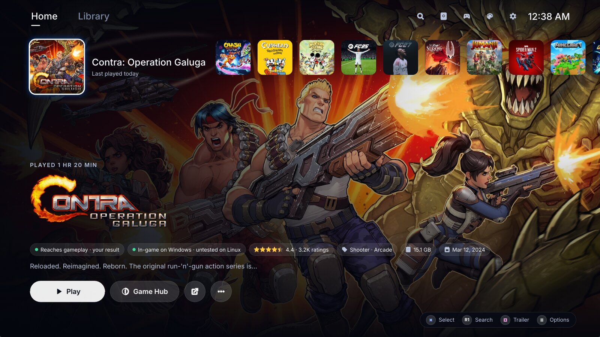
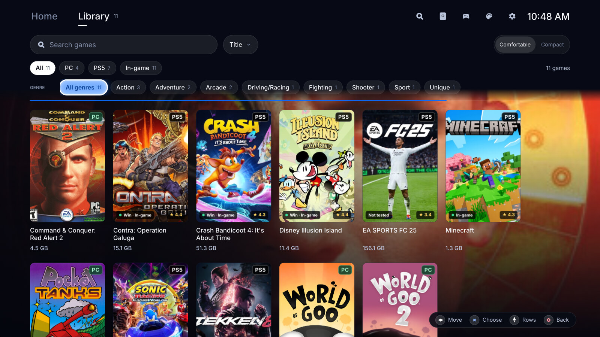
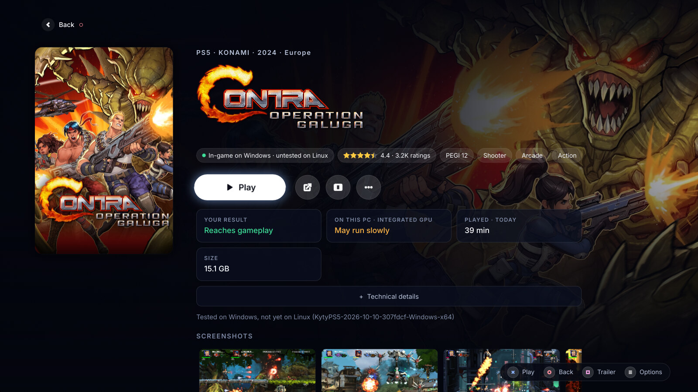
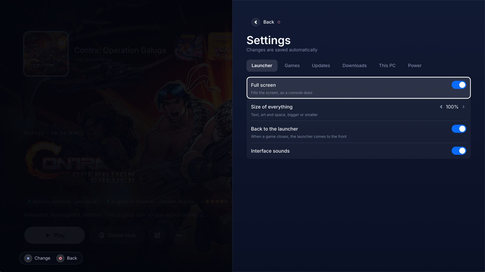
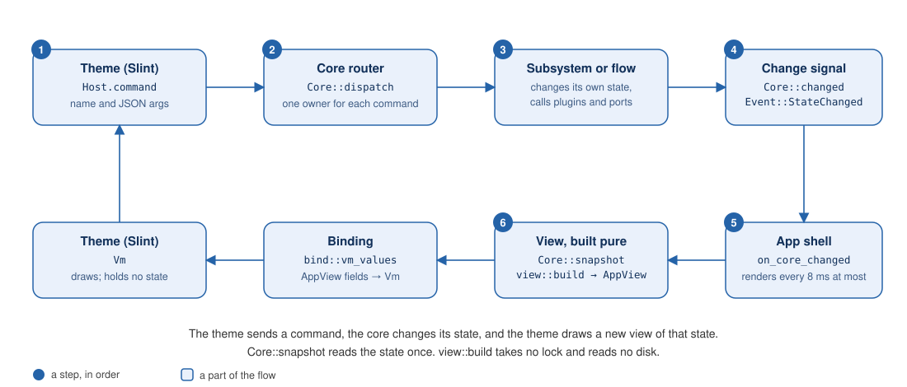

# Nexus

Nexus is a game launcher that helps players run their games from one screen made for a TV and a
controller. It runs on Linux, macOS and Windows. Nexus starts games through plugins: each emulator
or game source is a plugin, and each look is a theme that changes the whole layout, not only the
colors.

These plugins ship with Nexus today:

- **PS5**, with [KytyPS5](https://github.com/KytyPS5/KytyPS5).
- **PS4**, with [shadPS4](https://github.com/shadps4-emu/shadPS4).
- **PC games**, natively or through Wine or Proton.
- **Steam games**, on Linux.

They are the ones supported so far, not the limit of the design. Support for another emulator or
game source is another plugin, written against `nexus-api` and built into Nexus (a plugin found on
disk can only be a theme): see [docs/plugins.md](docs/plugins.md).

| Home | Library |
|---|---|
|  |  |

| Game Hub | Settings |
|---|---|
|  |  |

The screenshots show the built-in theme, `default`, on Linux, with a real library of PS5 and PC
games. The tests also render every screen offscreen with made-up games: run
`cargo test -p nexus-tests --test seams screenshots::`, and the PNG files go to
`target/tmp/screenshots/`.

## The problem

Emulators are separate programs. Each has its own builds, which change often, its own settings and
its own command line. PC games sit in folders, and the Windows ones need Wine or Proton set up.
None of this is made for a couch: you need a keyboard and a mouse to start a game.

Nexus puts all of it behind one library that works with a controller. It finds your games, shows
their art and facts, downloads and updates the official emulator builds, installs games, starts
them, and brings itself back when they close.

## What it does

- **Library.** It finds your PS5, PS4 and PC games in your game folders, and on Linux the games
  that Steam installed. Home is a row of games over the selected game's art. Library is a grid
  with search, sort and filters.
- **Game Hub.** One game's page: official art, facts, the community's compatibility result, your
  own result, how it should run on this PC, screenshots and the trailer.
- **Catalog and Downloads.** The games each console's catalog offers. Nexus downloads a release by
  BitTorrent into your packages folder, and can bind the download to your VPN and pause it when the
  VPN drops.
- **Installs.** Unsigned PS5 packages, exFAT disc images, PS4 fake packages and PC releases install
  into your game folders, with progress in Downloads.
- **Emulators.** Nexus downloads and updates the official KytyPS5 and shadPS4 builds, or runs a
  build of your own.
- **Themes.** Switching the theme keeps the screen you are on, your selection, the downloads and a
  running game.
- **Controller.** Every screen works with a gamepad, a keyboard or a pointer.
- **Updates.** Nexus updates its emulators, and itself from its GitHub releases.

## Does it work?

`make check` runs what CI runs: the format check, clippy with warnings as errors, and every test.

```sh
make check
```

CI (`.github/workflows/ci.yml`) runs Format, Clippy, Test and cargo-deny on Linux for every pull
request and every push to `main`. Most tests are seam tests: they run the real core, and on the
theme side the real app shell on Slint's testing backend, with fakes in place of the system, the
network and the clock. No test needs a window, a GPU, a controller or a sound device. A weekly run
(`weekly.yml`) adds what needs the network or real windows: the tests on Windows, the real KytyPS5
and shadPS4 releases, the desktop adapter under Xvfb, and the trailer player on a real video.

What no test covers: a real game running on real hardware. macOS and Windows builds run only in
`package.yml`, by hand or for a release. [docs/development.md](docs/development.md#tests) lists
the tests that need a real system and the variable that turns each one on.

## Install

Each [release](https://github.com/mohamed-rekiba/nexus/releases/latest) has these files, with a
`.sha256` file beside each and signed build provenance
(`gh attestation verify <file> --repo mohamed-rekiba/nexus` checks it).

| System | File | How to use it |
|---|---|---|
| Fedora (x86-64) | `nexus-<version>-1.x86_64.rpm` | `sudo dnf install ./nexus-<version>-1.x86_64.rpm` |
| Debian, Ubuntu (x86-64) | `nexus_<version>-1_amd64.deb` | `sudo apt install ./nexus_<version>-1_amd64.deb` |
| Arch (x86-64) | `nexus-<version>-1-x86_64.pkg.tar.zst` | `sudo pacman -U nexus-<version>-1-x86_64.pkg.tar.zst` |
| Linux (x86-64) | `nexus-linux-x86_64.tar.gz` | Unpack it and run `./install.sh` |
| Linux (x86-64) | `Nexus-x86_64.AppImage` | Make it executable and run it |
| macOS (Apple Silicon and Intel) | `nexus-macos-universal.dmg` or `.zip` | Open it and drag Nexus to Applications, or unzip it |
| Windows (x86-64) | `nexus-windows-x86_64-setup.exe` | Run it: it installs for you only, with no administrator |
| Windows (x86-64) | `nexus-windows-x86_64.zip` | Unzip it anywhere and run `nexus.exe` |

Each kind keeps itself up to date from Settings, Nexus updates. The macOS app and disk image, and
`nexus.exe` with its installer, are signed only when the release has the signing secrets
([docs/signing.md](docs/signing.md)). Without them, macOS Gatekeeper asks before the first start
and Windows SmartScreen warns.

### From source

You need [Rust](https://rustup.rs) 1.99 or newer and the build packages for your system. On Linux:

- Fedora: `sudo dnf install gcc gcc-c++ make pkgconf-pkg-config fontconfig-devel libxkbcommon-devel systemd-devel alsa-lib-devel`
- Debian and Ubuntu: `sudo apt-get install build-essential pkg-config libfontconfig1-dev libxkbcommon-dev libudev-dev libasound2-dev`

Then:

```sh
git clone https://github.com/mohamed-rekiba/nexus
cd nexus
make run            # build and run the launcher
```

`make run-windowed` opens a normal window, `make package` makes a release build in
`dist/nexus-<os>-<arch>/`, and `make` alone lists every target. The macOS and Windows build tools
are in [docs/development.md](docs/development.md#system-packages).

### First start

Nexus opens full screen. A Welcome screen shows what it sets up. Press Start once it is ready.
Nexus looks for games in `~/Games` and for packages in `~/Downloads` until you change the folders
in Settings. It keeps its settings and plugin data in one folder:

| System | Folder |
|---|---|
| Linux | `~/.local/share/nexus` (or `$XDG_DATA_HOME/nexus`) |
| macOS | `~/Library/Application Support/nexus` |
| Windows | `%APPDATA%\nexus` |

Nexus starts without any extra packages. Each one turns on a feature: `xdotool` brings games to the
front on X11, libmpv plays trailers in the window, libarchive unpacks RAR files, and umu-launcher
or Wine runs Windows games. The [user guide](docs/user-guide.md) lists them all, and covers folders,
the Catalog, installs, controls and Settings.

## Download Nexus OS

Nexus OS turns a spare PC into a console: it starts straight into Nexus, with no desktop, no
passwords and no pop-ups. It is a small, read-only Fedora system. It updates itself and Nexus in
the background, applies an update at the next restart, and keeps the previous version in the boot
menu. On a PC with an NVIDIA card it gets NVIDIA's driver by itself. It needs a 64-bit PC that
starts with UEFI.

<!-- x-release-please-start-version -->
The current version is Nexus OS 0.4.0:
[its release](https://github.com/mohamed-rekiba/nexus/releases/tag/nexus-os-v0.4.0).
All Nexus OS releases are tagged `nexus-os-v…` on the
[releases page](https://github.com/mohamed-rekiba/nexus/releases?q=nexus-os).

The release has one ISO, named with its version (`nexus-os-x86_64-0.4.0.iso`), to write to a USB
stick of 8 GB or more. When the ISO is over 2 GiB it comes in parts
(`nexus-os-x86_64-0.4.0.iso.part-aa`, `-ab`, …): download them all and join them into the ISO.

- Linux and macOS:

  ```sh
  v=0.4.0
  cat nexus-os-x86_64-$v.iso.part-* > nexus-os-x86_64-$v.iso
  ```

- Windows (Command Prompt), naming every part in order:

  ```bat
  set v=0.4.0
  copy /b nexus-os-x86_64-%v%.iso.part-aa + nexus-os-x86_64-%v%.iso.part-ab nexus-os-x86_64-%v%.iso
  ```

Then check the ISO against `nexus-os-x86_64-0.4.0.iso.sha256` (each part also has its own
`.sha256`):

- Linux: `sha256sum -c nexus-os-x86_64-0.4.0.iso.sha256`
- macOS: `shasum -a 256 -c nexus-os-x86_64-0.4.0.iso.sha256`
- Windows (PowerShell): `Get-FileHash nexus-os-x86_64-0.4.0.iso`, and compare it with the file's
  first word.

To try the ISO in a virtual machine first, on Fedora, from a clone of this repository:

```sh
sudo dnf install qemu-kvm qemu-img edk2-ovmf
os/run-vm.sh path/to/nexus-os-x86_64-0.4.0.iso
```

<!-- x-release-please-end -->

The VM starts the ISO as a USB stick in a UEFI virtual machine with Secure Boot, and gives it an
empty 64 GB disk (`os-vm.qcow2`) to install on, kept between starts. The stick stays attached after
an install: to start the installed system, run the same command and choose the disk in the VM's boot
menu (press Esc while it starts). [os/README.md](os/README.md) has what to check.

Write the ISO to the USB stick with [balenaEtcher](https://etcher.balena.io): choose the ISO, the
USB stick, then **Flash**. Start the PC from the stick (its boot menu key is usually F12, F11, F8
or Esc). Nexus OS starts from the stick without changing anything on the PC. From there:

- **Try it:** play from the stick.
- **Install on this PC:** pick a disk in Nexus. It erases that whole disk.
- **Choose partitions instead:** Fedora's installer, to keep Windows or use free space. It needs a
  keyboard and a mouse. It is also the boot menu entry "Install Nexus OS (choose partitions)"; hold
  Esc or Shift while the stick starts to see the menu.

Both installs copy the system stored on the stick, so neither needs internet. With an NVIDIA card
and Secure Boot on, a blue "MOK management" screen appears once at the next restart: choose
**Enroll MOK**, **Continue**, **Yes**, type `universalblue`, then **Reboot**. How Nexus OS is built
is in [os/README.md](os/README.md), and what Nexus and the OS expect from each other is in
[docs/nexus-os.md](docs/nexus-os.md).

## How it is built

Nexus is one binary built from crates in one Cargo workspace. A small core runs plugins. Emulator,
service and system plugins are compiled in and reach the host only through `nexus-api`. Themes are
data that the UI host loads, swaps and rolls back. Data flows one way: the UI sends a command, the
core changes its state, and the UI draws a new view of that state.



The flow: a theme sends a command, the core changes its state and signals a change, the shell
renders, and the view builds from one snapshot and binds back into the theme.

| Path | What it is |
|---|---|
| `crates/nexus-api` | The plugin contract. The only crate a plugin depends on. |
| `crates/nexus-ui-api` | The theme contract: view models, screens, tokens, `theme.toml`. |
| `crates/nexus-core` | The core: plugin lifecycle, settings, downloads, torrents, installs, launches, updates. No UI code. |
| `crates/nexus-ui-host` | Shows themes with Slint: inheritance, switching with rollback, input, and the app shell. |
| `crates/nexus-app` | The `nexus` binary and the adapters for each system: windows, controllers, sounds, trailers, archives, torrents. |
| `crates/nexus-testkit` | The fake host, fake clock, fakes for the system, and the plugin contract checks. |
| `plugins/` | The built-in emulators (KytyPS5, shadPS4, PC, Steam), services (Game Catalog, PlayStation Store), the system plugin, the `default` theme and the code the emulators share. |
| `tests/` | The seam tests. |
| `assets/`, `scripts/`, `packaging/`, `os/` | The bundled catalogs and icons, the check and packaging scripts, the Linux, macOS and Windows packaging, and Nexus OS. |

[docs/architecture.md](docs/architecture.md) explains each part.

### Decisions and trade-offs

- **Themes are data, and the only third-party code.** Nexus has no runtime for third-party code. A
  plugin found on disk must be a data-only theme. Slint markup cannot reach the disk, because the
  compiler serves only a virtual folder (`VFS_ROOT` in `crates/nexus-ui-host/src/compile.rs`), so a
  theme needs no sandbox. The cost: nobody can add an emulator without building Nexus.
- **The kind of plugin governs privileges, not capabilities.**
  [ADR 0001](docs/adr/0001-capabilities-follow-the-capability-not-the-kind.md): any plugin with code
  may provide the data capabilities, because they only give the core data. Only a `system` plugin
  may declare the system capabilities. The Steam plugin is an emulator that lists releases and
  describes games.
- **The reads for a game's page stay as separate flows.**
  [ADR 0002](docs/adr/0002-game-page-reads-stay-as-flows.md): each flow crosses a different pair of
  areas, and no step repeats.
- **Slint is pinned to one version.** `Cargo.toml` pins `slint` and `slint-interpreter` with `=`
  because the `internal` feature gives `create_with_existing_window`, which swaps themes in one
  window.
- **Dependencies build optimized in debug builds.** `[profile.dev.package."*"]` builds them at
  `opt-level = 2`, so image decoding, JSON and Slint run near release speed under `cargo run` and
  in the tests. The workspace's own crates build at `opt-level = 1`, so a change rebuilds fast.
- **The licence is the GPL.** The PS4 package reader is a port of shadPS4 code, which is
  GPL-2.0-or-later.

### CI/CD

- **Pull requests and `main`:** `ci.yml` runs Format, Clippy, Test and cargo-deny on Linux. A new
  push cancels the older run of the same branch. It skips Markdown, `docs/`, `os/` and the other
  workflows.
- **Weekly:** `weekly.yml` runs the slow checks listed above.
- **Releases:** [Release Please](https://github.com/googleapis/release-please) keeps a release pull
  request open for Nexus and one for Nexus OS, from Conventional Commit messages. Merging one makes
  a draft release and a tag. `release.yml` then starts `package.yml` (the packages on Linux, macOS
  and Windows, signed when the secrets are set) or `os.yml` (the Nexus OS images and USB stick) on
  that tag.

The full list is in [docs/development.md](docs/development.md#ci).

## Limitations

- Retail PS5 packages do not install, because the console holds their keys. Only unsigned PS5
  packages, exFAT images and PS4 fake packages do.
- Steam games play on Linux only, and the Nexus OS image does not include Steam.
- Nexus finds PC games in the game folders you set, and Steam's games through the Steam plugin.
- "This PC" judges by the numbers in each emulator's manifest, not by how fast a game runs here.
- "Download only through a VPN" is not available on Windows, because the torrent library
  (librqbit) cannot bind a connection to an interface there.
- Following a game that another program starts, as Steam does, needs the Unix process search, so it
  does not work on Windows.
- On a Wayland desktop other than KDE Plasma, a native Wayland game does not come to the front by
  itself.
- On macOS, without the Accessibility permission a notice says so, and the controller stays with
  the game until the PS button.
- The catalog refresh brings an existing catalog up to date. It cannot build one from nothing.
- Nexus runs no third-party code. Third-party plugins are themes only.

## Documentation

| Document | What it covers |
|---|---|
| [docs/user-guide.md](docs/user-guide.md) | Setting up each system, folders, the Catalog, installs, controls, Settings |
| [docs/architecture.md](docs/architecture.md) | How the core, the plugins and the UI host fit together |
| [docs/development.md](docs/development.md) | Building, testing, packaging and CI |
| [docs/plugins.md](docs/plugins.md) | Writing a plugin |
| [docs/themes.md](docs/themes.md) | Writing a theme |
| [docs/reference/default-theme.md](docs/reference/default-theme.md) | The default theme, screen by screen |
| [docs/reference/desktop.md](docs/reference/desktop.md) | Windows, focus and controllers on each system |
| [docs/reference/archives-and-pc-games.md](docs/reference/archives-and-pc-games.md) | Archives in downloads, and PC games |
| [docs/nexus-os.md](docs/nexus-os.md) | What Nexus and Nexus OS expect from each other |
| [docs/signing.md](docs/signing.md) | Signing and notarizing the release packages |
| [docs/third-party-notices.md](docs/third-party-notices.md) | Code and libraries from other projects, and their licences |
| [os/README.md](os/README.md) | Building and testing Nexus OS |
| [scripts/catalog/README.md](scripts/catalog/README.md) | Making and refreshing the catalog files |
| [GLOSSARY.md](GLOSSARY.md) | The words the code and the docs use |

## Contributing

Run `make check` before you push. `make hooks-install` installs the git hooks (format on commit;
clippy and tests on push). Write commit messages as Conventional Commits, such as `feat(core): …`
or `fix: …`: Release Please makes the releases from them. `docs:`, `ci:`, `refactor:`, `test:` and
`chore:` make no release. Start at [docs/development.md](docs/development.md).

## Licence

Nexus is licensed under the GNU General Public License, version 2 or later (`LICENSE`), because the
PS4 package reader is a port of shadPS4 code. The default theme's fonts, Inter and Tajawal, are under
the SIL Open Font License 1.1. Other code and the libraries the packages ship (libmpv, FFmpeg,
libarchive) keep their own licences: see
[docs/third-party-notices.md](docs/third-party-notices.md).
