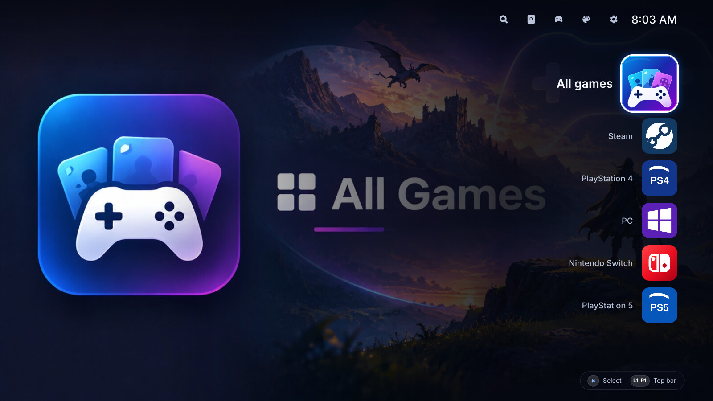
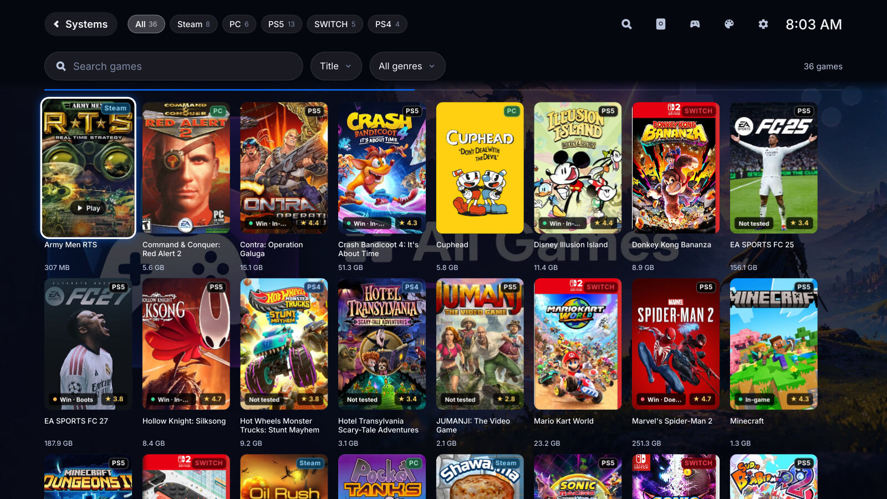
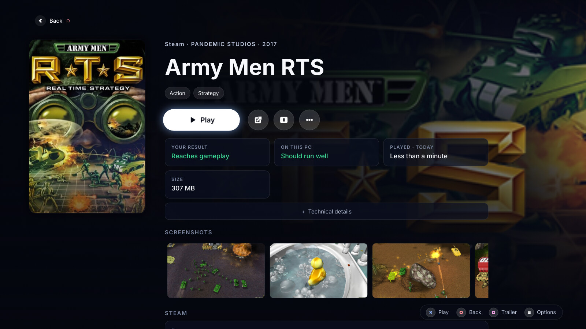
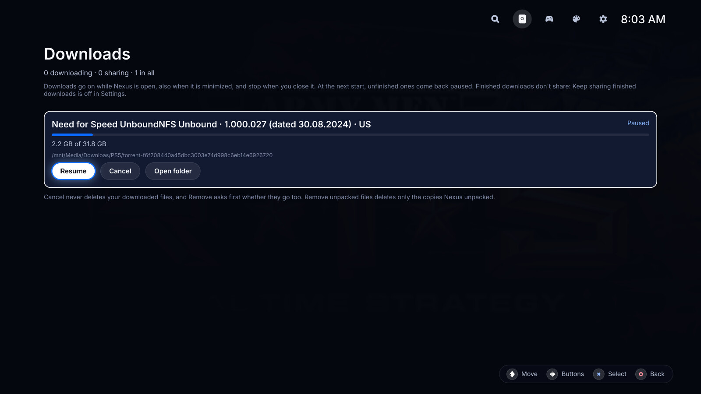
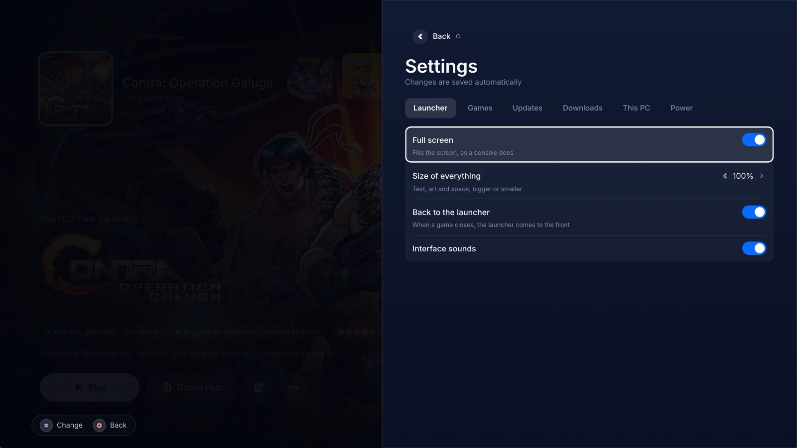
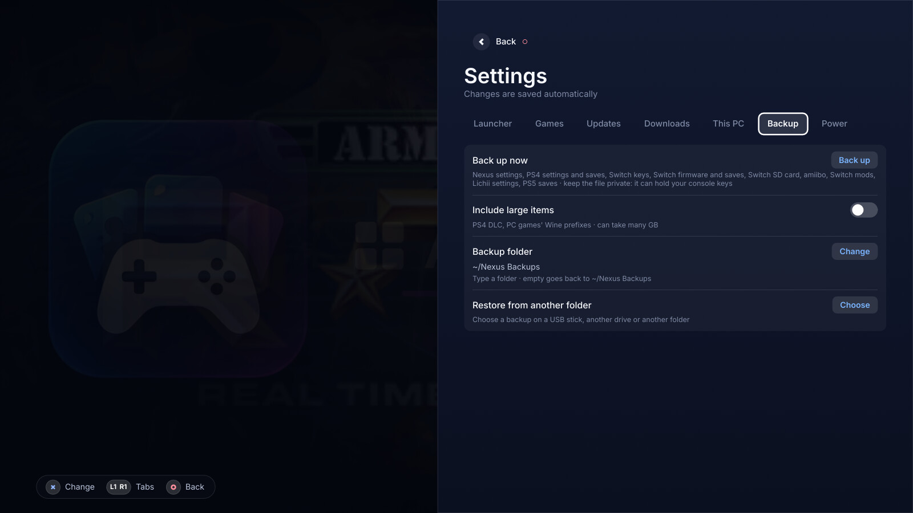
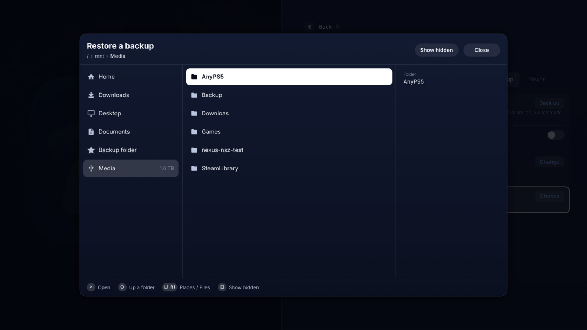

# Nexus

Nexus is a game launcher for a TV and a controller. It puts your games from emulators, PC
folders and Steam in one library, and you play them from the couch. It runs on Linux, macOS and
Windows, and it is the whole screen of Nexus OS.

Nexus finds your games, shows their art and details, downloads and updates the emulators,
installs games, starts them, and comes back to the front when a game closes. A keyboard and a
mouse work too.

## What it plays

Each source of games is a plugin built into Nexus.

| Plugin | What it plays | Systems |
| --- | --- | --- |
| PS5 | PS5 games, with [KytyPS5](https://github.com/KytyPS5/KytyPS5) | Linux, macOS, Windows |
| PS4 | PS4 games, with [shadPS4](https://github.com/shadps4-emu/shadPS4) | Linux, macOS, Windows |
| Switch | Switch games, with [Lichii](https://github.com/zortos293/Lichii). Downloads firmware and the selected keys version when enabled. | Linux |
| PC | PC games: native games, and Windows games through umu-launcher (Proton) or Wine | Linux, macOS, Windows |
| Steam | The games Steam installed, started through Steam | Linux |

Two service plugins add data. The **Game Catalog** lists the releases each console's catalog
offers to download. The **PlayStation Store** adds official art and details to PS4 and PS5
games.

Nexus ships two themes, **Default** and **Classic**. A theme changes the whole layout, not only
the colours. You can add more themes; a theme is data and runs no code.

## Screenshots

| Home | Library |
| --- | --- |
|  |  |

| Game Hub | Downloads |
| --- | --- |
|  |  |

| Settings | Settings → Backup |
| --- | --- |
|  |  |

The backup browser:



The screenshots show the Default theme at 1600 × 900.

## Install

Download Nexus from the
[latest release](https://github.com/mohamed-rekiba/nexus/releases/latest). Each file has a
`.sha256` file beside it and signed build provenance:
`gh attestation verify <file> --repo mohamed-rekiba/nexus` checks it.

| System | File | How to install |
| --- | --- | --- |
| Fedora (x86-64) | `nexus-<version>-1.x86_64.rpm` | `sudo dnf install ./nexus-<version>-1.x86_64.rpm` |
| Debian, Ubuntu (x86-64) | `nexus_<version>-1_amd64.deb` | `sudo apt install ./nexus_<version>-1_amd64.deb` |
| Arch (x86-64) | `nexus-<version>-1-x86_64.pkg.tar.zst` | `sudo pacman -U nexus-<version>-1-x86_64.pkg.tar.zst` |
| Linux (x86-64) | `nexus-linux-x86_64.tar.gz` | Unpack it and run `./install.sh` |
| Linux (x86-64) | `Nexus-x86_64.AppImage` | Make it executable and run it |
| macOS (Apple Silicon and Intel) | `nexus-macos-universal.dmg` or `nexus-macos-universal.zip` | Open the disk image and drag Nexus to Applications, or unzip the app |
| Windows (x86-64) | `nexus-windows-x86_64-setup.exe` | Run it. It installs Nexus for you only and needs no administrator. |
| Windows (x86-64) | `nexus-windows-x86_64.zip` | Unzip it and run `nexus.exe` |

`install.sh` needs no `sudo`. It puts Nexus in `~/.local/lib/nexus` (set `PREFIX` to use another
place than `~/.local`), links `~/.local/bin/nexus` to it, and adds Nexus to your app menu. Run
it from a newer package to update. `./install.sh --uninstall` removes Nexus and keeps your
settings.

The deb, rpm and Arch packages also add a **Nexus** session to the login screen: Nexus as the
whole screen, with no desktop behind it.

Nexus updates itself from Settings → Updates → **Nexus updates**. The macOS app and the Windows
program are signed only when the release was made with the signing keys
([docs/signing.md](docs/signing.md)). An unsigned build makes macOS Gatekeeper ask before the
first start, and Windows SmartScreen warn.

To build Nexus from source, see [docs/development.md](docs/development.md). In short: install
Rust 1.99 or newer and your system's build packages, then run `make run`.

## Download Nexus OS

Nexus OS turns a PC into a console. It starts straight into Nexus, with no desktop.

<!-- x-release-please-start-version -->
The current version is Nexus OS 0.11.2:
[its release](https://github.com/mohamed-rekiba/nexus/releases/tag/nexus-os-v0.11.2).
Every Nexus OS release is tagged `nexus-os-v…` on the
[releases page](https://github.com/mohamed-rekiba/nexus/releases?q=nexus-os).

The release has one ISO file for a USB stick, `nexus-os-x86_64-0.11.2.iso`. An ISO over 2 GiB
comes in parts (`nexus-os-x86_64-0.11.2.iso.part-aa`, `-ab`, …). Download every part, then join
them into the ISO:

- Linux and macOS:

  ```sh
  v=0.11.2
  cat nexus-os-x86_64-$v.iso.part-* > nexus-os-x86_64-$v.iso
  ```

- Windows (Command Prompt). Name every part, in order:

  ```bat
  set v=0.11.2
  copy /b nexus-os-x86_64-%v%.iso.part-aa + nexus-os-x86_64-%v%.iso.part-ab nexus-os-x86_64-%v%.iso
  ```

Check the ISO against `nexus-os-x86_64-0.11.2.iso.sha256`. Each part also has its own `.sha256`.

- Linux: `sha256sum -c nexus-os-x86_64-0.11.2.iso.sha256`
- macOS: `shasum -a 256 -c nexus-os-x86_64-0.11.2.iso.sha256`
<!-- x-release-please-end -->

Write the ISO to a USB stick and start the PC from it. Nexus OS starts from the stick. Then
choose:

- **Try it**: play from the USB stick.
- **Install on this PC**: pick a disk of 40 GB or more. The install erases that whole disk.
- **Choose partitions instead**: Fedora's installer, to keep another system or use free space.
  The boot menu of the stick has the same entry, "Install Nexus OS (choose partitions)".

How Nexus OS is built and tested is in [os/README.md](os/README.md). What Nexus and Nexus OS
expect from each other is in [docs/nexus-os.md](docs/nexus-os.md).

## Where to go next

- [docs/user-guide.md](docs/user-guide.md): every screen, the controller keys, backups, where
  Nexus keeps your data, and what to do when something goes wrong.

For contributors:

| Document | What it covers |
| --- | --- |
| [docs/development.md](docs/development.md) | Building, testing, packaging and CI |
| [docs/architecture.md](docs/architecture.md) | How the core, the plugins and the UI host fit together |
| [docs/plugins.md](docs/plugins.md) | Writing a plugin |
| [docs/themes.md](docs/themes.md) | Writing a theme |
| [docs/reference/classic-theme.md](docs/reference/classic-theme.md) | The Classic theme, screen by screen |
| [docs/reference/desktop.md](docs/reference/desktop.md) | Windows, focus and controllers on each system |
| [docs/reference/archives-and-pc-games.md](docs/reference/archives-and-pc-games.md) | Archives in downloads, and PC games |
| [docs/nexus-os.md](docs/nexus-os.md) | What Nexus and Nexus OS expect from each other |
| [docs/signing.md](docs/signing.md) | Signing the release packages |
| [docs/third-party-notices.md](docs/third-party-notices.md) | Code and libraries from other projects, and their licences |
| [GLOSSARY.md](GLOSSARY.md) | The words the code and the docs use |

## Thanks

Nexus is inspired by [Azrak Launcher](https://github.com/AzrakHQ/azrak-launcher) and
[AzrakOS](https://github.com/AzrakHQ/azrak-os).

## Licence

Nexus is under the GNU General Public License, version 2 or later ([LICENSE](LICENSE)). The
fonts of the built-in themes, Inter and Tajawal, are under the SIL Open Font License 1.1. Other
code and the libraries the packages ship keep their own licences: see
[docs/third-party-notices.md](docs/third-party-notices.md).
