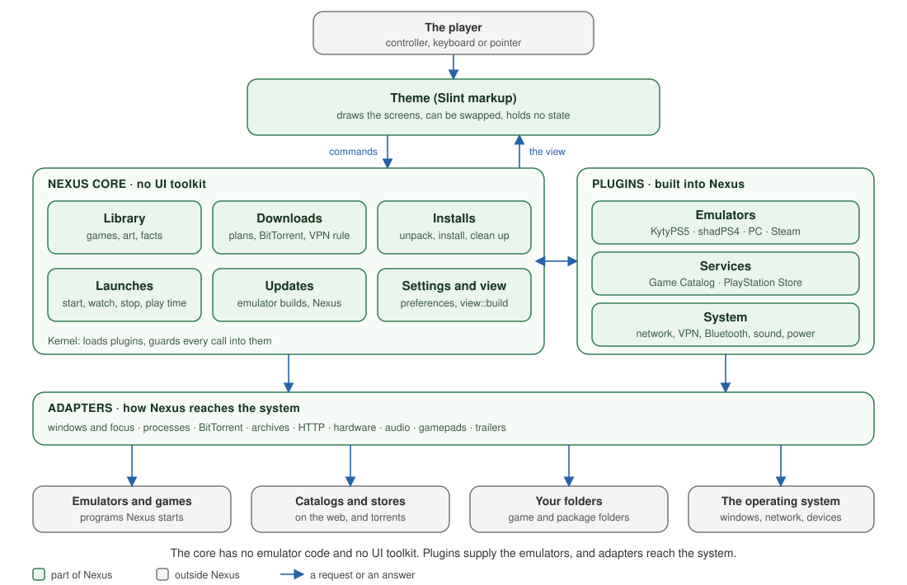
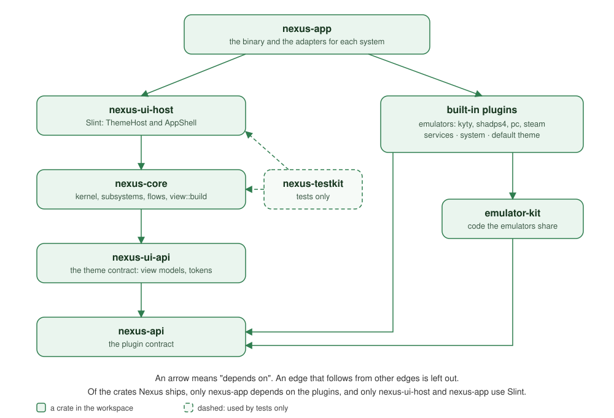
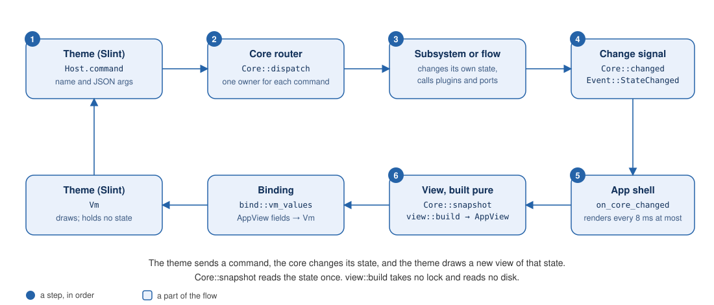

# Architecture

This page shows how Nexus is built: the crates, the ports, the core and its view, the UI host
and its themes, plugins, backup and restore, the data folder and the tests. It is for
contributors. Every name in `code` is a name in the source; search for it.

- Writing a plugin: [plugins.md](plugins.md). Writing a theme: [themes.md](themes.md).
- Building, checking and releasing: [development.md](development.md).
- Windows, focus and controllers on each system: [reference/desktop.md](reference/desktop.md).
- Archives and PC games: [reference/archives-and-pc-games.md](reference/archives-and-pc-games.md).
- The words this page uses: [GLOSSARY.md](../GLOSSARY.md).
- The decisions behind the shape: [Decisions](#decisions).

## Overview

<!-- TODO: overview.svg names no Lichii emulator and no Backup part in the core. -->

The player uses a theme. The theme sends commands to the core and draws the view the core
builds. The core works with plugins, and reaches the system through ports that the app fills
with adapters. The sections below take each part in turn.

## Crates

Nexus is one binary, built from the crates of one Cargo workspace (`Cargo.toml`). The crate
graph is the boundary: a crate can't use what it doesn't depend on.

<!-- TODO: crate-graph.svg lists the emulators as "kyty, shadps4, pc, steam" (no lichii) and
the themes as "default theme" (no classic). -->

An arrow means "depends on". `nexus-app` depends on `nexus-ui-host` and the built-in plugins.
`nexus-ui-host` depends on `nexus-core`, `nexus-core` on `nexus-ui-api`, and every crate on
`nexus-api`. The emulators that download builds also use `emulator-kit`. `nexus-testkit` serves
the tests only.

| Crate | Owns |
| --- | --- |
| `crates/nexus-api` | The plugin contract: the plugin traits, `PluginManifest`, `Capability`, `Provided`, `PluginContext`, `Event`, the `Backup` capability. Versioned by `API_VERSION`, set by hand; a manifest's `host_api` must include it. The only crate a plugin depends on. |
| `crates/nexus-ui-api` | The theme contract: the view models (`vm.rs`, `AppView` and its parts), `ThemeManifest` (`theme.rs`), the design tokens with their defaults (`tokens.rs`), `contract/types.slint` with the `Vm` and `Host` globals, and the kit (`kit/*.slint`, listed in `KIT` in `contract.rs`). Versioned by `UI_API_VERSION`; a theme's `ui_api` must include it. No toolkit code. |
| `crates/nexus-core` | The kernel and the app: `Kernel`, `EventBus`, `ConfigService`, the ports (`ports.rs`), `Core` and `Command`, the subsystems, the flows between them, `Snapshot` and `view::build`. No UI toolkit and no emulator code. |
| `crates/nexus-ui-host` | Shows themes with Slint: `ThemeSet` (finds themes, picks the fallback theme, checks their files), `ThemeHost` (compiles a theme, binds the view, swaps themes) and `AppShell` (carries out the theme's requests, coalesces renders, loads images, runs the tick). |
| `crates/nexus-app` | The `nexus` binary: `main.rs`, the command line (`args.rs`), the launcher update (`update.rs`), the gamepads, audio and trailers, and the adapters for each port. |
| `crates/nexus-testkit` | `FakeHost`, `FakeClock`, the fakes for the ports, `FakePlatform`, `StubPlugin`, `FakeBackup`, `FakeCatalog`, `FakeStore`, `FakeService`, `FakeEmulator`, `FakeSystem`, `ThemeDriver`, `MemStorage`, `SpanRecorder` and the capability contracts (`contract`). |
| `plugins/emulators/*` | `emu-kyty` (KytyPS5, PS5), `emu-shadps4` (PS4), `emu-lichii` (Switch and Switch 2), `emu-pc` (PC games), `emu-steam` (Steam games, Linux only). |
| `plugins/services/*` | `playstation-store` (store art and details) and `release-catalog` (the Game Catalog). |
| `plugins/system/host` | `system-host`: the system plugin with the id `system`. |
| `plugins/themes/default` | `theme-default`: the built-in theme `default`, the fallback theme. A crate only so the binary embeds its files. |
| `plugins/themes/classic` | `theme-classic`: the built-in theme `classic`. A crate for the same reason. |
| `plugins/shared/emulator-kit` | Code the emulator plugins share. A library, not a plugin. |
| `tests/` | The seam tests, in the crate `nexus-tests`. |

Rules the graph keeps:

- Of the crates Nexus ships, only `nexus-ui-host` and `nexus-app` use Slint.
- Only `nexus-app` reaches the system's own facilities: windows, processes, BitTorrent, archives,
  hardware, gamepads, audio and trailers. The core reaches them through ports.
- No plugin depends on another plugin. The core names no plugin.
- The workspace denies `unsafe_code` (`[workspace.lints.rust]`). A module that allows it says
  why on the same line. Search for `allow(unsafe_code)` to list them.

A plugin's id, not its folder or its crate, names its data folder and its settings.

## Threads

The core runs on a multi-threaded tokio runtime. The UI runs on the main thread, in Slint's event
loop, where `AppShell` owns the `ThemeHost`. The two meet in two places:

- A theme callback becomes a `UiRequest`. The shell queues it and carries it out later, so a
  request never runs inside the callback that made it. The shell gives core commands and image
  loads to `Platform::spawn`, which the app runs on the runtime.
- Core events, gamepad presses and finished work come back to the UI thread through
  `slint_interpreter::invoke_from_event_loop` (`nexus-app/src/main.rs`, `platform.rs`).

The shell has no timer of its own. It reads the time from the core's `Clock` port and asks the
platform to wake it with `Platform::wake_in`. The app also calls `AppShell::on_tick` every
`TICK` (250 ms) with a Slint timer.

## Commands and the view

Data flows one way. A theme sends a command, the core changes its state and signals a change,
the shell renders, and the view builds from one snapshot and binds back into the theme.

1. A theme calls `Host.command(name, args)`. The host reads the name and the JSON args as a
   core `Command` with `serde`. No code exists for each command. The other `Host` callbacks are
   things only the app can do: switch theme, play a sound, open a link or a path, quit,
   restart, log out, the trailer, and say which cards a grid shows, so their covers load
   (`grid-window`).
2. `Core::dispatch` sends the command to the subsystem or the flow that owns it. `Command`
   nests a subsystem's commands, such as `Command::Backup(BackupCmd)` or
   `Command::Session(SessionCmd)`. Other commands keep flat names that themes send, such as
   `Command::Back` and `Command::LibrarySort`.
3. The owner changes its state and names the `Area` that changed. A subsystem does this
   through its `Notifier`. That sends a `Change { area }` on `Core::changes()` and publishes
   `Event::StateChanged` on the `EventBus`. The core and its tests read the area; the app
   renders on any change. Plugins see neither.
4. `main.rs` reads every event from `core.events()` and calls `AppShell::on_core_changed`. An
   atomic flag keeps at most one call waiting on the UI thread.
5. The shell renders at most once per `RENDER_GAP` (8 ms). Images that arrive later render on
   their own, at most once per `IMAGES_GAP` (100 ms).
6. `ThemeHost::render` calls `Core::view`. That takes a `Snapshot` (`Core::snapshot`) and runs
   `view::build` over it, which returns an `AppView`. `bind::vm_values` turns the `AppView` into
   Slint values (`values.rs`): each field becomes a `Vm` property of the same name in kebab case.

The areas (`Area`, `changes.rs`) are `Navigation`, `Library`, `Catalogs`, `Downloads`,
`Installs`, `Torrents`, `Sessions`, `Notices`, `Settings`, `Plugins`, `System`, `Vpn`,
`Hardware`, `LauncherUpdate` and `Backup`.

`Snapshot` (`snapshot.rs`) holds one read of each subsystem, a copy of `AppState`, the plugins'
manifests, the theme's option values, the time by the core's clock, and what the view needs
from the disk (`Files`). `view::build` (`view.rs`) is pure: it takes no lock, does no I/O and
keeps no state. Display text, such as sizes and dates, is written in `display.rs` as the view
builds. The view's rules live in pure modules over the snapshot, each with its own tests:
`ownership.rs`, `grid_query.rs`, `settings_schema.rs`, `disks.rs`, `game_words.rs` and
`releases.rs`.

A theme holds no state. A theme switch loses nothing: the new theme binds to the same
`AppView`. A drift test in `nexus-ui-host` (`drift.rs`) fails when `contract/types.slint` and the
view models name different fields.

## Ports and adapters

The core reaches the outside world through traits in `crates/nexus-core/src/ports.rs`.
`KernelBuilder` starts with a stand-in for each port. The app plugs in the real adapter
(`nexus-app/src/main.rs`), and the test kit has a fake.

| Port | Stand-in | App adapter | Test fake |
| --- | --- | --- | --- |
| `HttpTransport` | `NoNetwork` | `http::ReqwestTransport` | `FakeHttp` |
| `ProcessSpawner` | `TokioSpawner` | `TokioSpawner` (the stand-in) | `FakeSpawner` |
| `ProcessTree` | `GroupTree` | `processes::SystemProcesses` | `FakeProcessTree` |
| `Windows` | `NoWindows` | `desktop::SystemWindows` | `FakeWindows` |
| `LoginSession` | `NoLoginSession` | `desktop::SystemLoginSession` | `FakeLoginSession` |
| `Opener` | `NoOpener` | `desktop::SystemOpener` | `FakeOpener` |
| `Hardware` | `NoHardware` | `hardware::SystemHardware` | a fixed `Hardware` in `FakeHost` |
| `Torrents` | `NoTorrents` | `torrents::RqbitTorrents` | `FakeTorrents` |
| `Network` (VPNs) | `NoVpn` | none: a system plugin's `vpn` capability takes its place (`PluginVpn`) | `FakeNetwork` |
| `Archives` | `NoArchives` | `archives::HostArchives` | `FakeArchives` |
| `Clock` | `TokioClock` | `TokioClock` | `FakeClock` |

`TokioSpawner` and `GroupTree` are real adapters, so they live in `process.rs`.

Boot builds the ports once into one bundle, `Ports`. The bundle also makes the VPN rule
(`VpnRule`) over the `Network` port. `Core::start` splits the bundle, so each subsystem gets
only the ports it names: `Ports::torrents()`, `installs(..)`, `sessions()`, `preferences()`,
`downloads()` and `launcher_update()`.

The app shell has a port of its own: `Platform` (`nexus-ui-host/src/shell.rs`). It runs work off
the UI thread, wakes the shell, opens links and paths, quits and restarts, writes the lines the
Nexus session reads (`announce`), plays sounds and trailers, reads the local time, and asks
about monitors and window focus. The app plugs in `platform::SystemPlatform`. Tests plug in
`FakePlatform`, which records each call.

## The core

### Subsystems

`Core` (`app.rs`) is a router. It starts the subsystems, sends each command to its owner,
merges their changes into `Core::changes()`, and reads them all into one `Snapshot`.

| Subsystem | Module | Owns |
| --- | --- | --- |
| `TorrentsSubsystem` | `torrents/` | The Catalog's downloads, their phases (`torrents/phase.rs`) and the VPN kill switch. |
| `GameInstallsSubsystem` | `game_installs/` | Game installs from a download or a package, and the unpack of a download's archives. |
| `LibrarySubsystem` | `library/` | The game records, the catalogs' copies and offers, hidden games, kept art and the player's results. |
| `SessionsSubsystem` | `sessions/` | The running games: see [Sessions and windows](#sessions-and-windows). |
| `Preferences` | `preferences.rs` | The app's one-value settings (`Pref`), saved as `app.<key>`. |
| `NoticesSubsystem` | `notices.rs` | The notices, at most `MAX_NOTICES`. |
| `VpnSubsystem` | `vpn.rs` | "Download only through a VPN" and the VPNs. |
| `LauncherUpdateSubsystem` | `launcher_update.rs` | The launcher's own update. |
| `BackupSubsystem` | `backup/` | Settings → Backup: see [Backup and restore](#backup-and-restore). |

The emulator downloads run in `Downloads` (`downloads.rs`), one long-lived task that the core
feeds through a channel.

A subsystem follows these rules:

- It owns its state behind its own lock, and its saved records. Nothing else takes that lock or
  writes those keys.
- It takes only the ports it needs, never the `Kernel` or the `Core`.
- The core sends it commands and reads it whole (`snapshot()`). A read changes nothing.
- It names its changes with its area through a `Notifier`.
- What other areas must do about a change goes out as an event (`TorrentEvent`,
  `InstallEvent`), which the core turns into work. A subsystem never calls into the core.
- A command that needs another area first is resolved by the core, which hands the subsystem
  plain data.

What no subsystem owns stays in `AppState` (`app_state.rs`), behind one mutex in `Core`: the
screen stack (`nav`, a list of `Route`), the selection, the grids' queries, each emulator's
builds, the Settings panels, the install and result prompts, the machine's state, the stores'
installs and the theme on screen.

### Flows

Work that crosses areas is a flow: a free function over the core, in its own module. The core
routes a command to a flow when no one subsystem owns it.

| Flow | Does |
| --- | --- |
| `navigation.rs` | Moves the player between screens, and sets the grids' search, filters, sort and pages. |
| `emulator_builds.rs` | Installs, updates and removes emulator builds, and checks for updates. |
| `plugin_downloads.rs` | Starts and resumes a plugin's download plans. |
| `plugin_settings.rs` | Sets plugin settings and theme options, runs plugin actions, maps host folders, turns plugins on or off. |
| `release_downloads.rs` | Resolves the Catalog's downloads and installs, and turns torrent and install events into work. |
| `launch.rs` | Starts games, ends their sessions, and asks "How far did it get?". |
| `library_reads.rs`, `catalog_reads.rs` | Read the plugins for the library and the catalogs. |
| `uninstall.rs` | Removes an installed game. |
| `system.rs` | Runs the machine's settings through the system plugin. |
| `backups.rs` | Settings → Backup's commands. |

[ADR 0002](adr/0002-game-page-reads-stay-as-flows.md) records why the reads for a game's page
stay separate flows.

### The launcher's update

`launcher_update.rs`. A release publishes `latest.json`: its version, and each package's address
and SHA-256 for each kind of install. `LauncherUpdateSubsystem` reads it from the repo in
`app.update_repo`, downloads this install's package and checks its SHA-256. The package is
then kept in `updates/` with `ready.json`, or handed to the system's package manager. At the
next start, `apply_launcher_update` (`nexus-app/src/update.rs`) puts a kept update in. On Nexus
OS the system updates the launcher, so nothing is downloaded.

## Sessions and windows

The sessions subsystem (`sessions/`) owns the running games: their sessions, `game_in_front`,
the one-game-at-a-time claim, Stop, the window focus calls and the play time (`app.playtime`).
`Command::Session(SessionCmd)` carries `Launch`, `Stop`, `ShowGame` and `ToggleFocus`. Its
ports are `ProcessSpawner`, `ProcessTree`, `Windows` and `Clock` (`SessionPorts`).

A launch needs the plugin first, so the core resolves it in `launch.rs`. It claims the subsystem
(`SessionsSubsystem::claim`) before its checks, so two presses of Play can't both start a game.
It gets the plugin's `LaunchSpec`, checks the program against `permissions.process`, and hands
the subsystem a `NewSession` to spawn.

The watch (`sessions/watch.rs`) follows the game until it ends. A game is its processes, as
`ProcessTree::members` lists them: the process Nexus started, its process group, and what a
sandbox moved out of the group. The game ends when none of them is left. On the way the watch
uses the `Windows` port:

- Until the game shows, it calls `show_game` to bring the game's window to the front.
- After that, while the game keeps the screen, it calls `keep_game` on each look. Under
  Gamescope the adapter tags each new window of the game, so the windows a game opens after it
  showed stay on screen. On other desktops `keep_game` does nothing. The player's PS button
  (`ToggleFocus`) brings the launcher back and stops this.
- It reads `front` and `has_window`. Where `window_close_ends_game` is true (macOS), a game
  whose window is gone for `WINDOW_GONE_FOR` looks in a row is over.

A launch can hand the game to another program (`LaunchSpec::game_process`). The watch then finds
the game by its command line (`ProcessTree::find`).

When the game ends, the core's `launch.rs` ends the session and applies one pure rule,
`sessions::outcome` (`sessions/ending.rs`). It decides the notice the ending earns and whether
the core asks "How far did it get?".

While a game's window is in front, or the launcher's window doesn't have the focus, `ThemeHost`
drops the gamepad's presses. Only the PS button's actions reach the launcher.

## Backup and restore

Settings → Backup makes one file that holds the app's settings and what each plugin names of its
data. The work splits in three:

- **The plugins name their items.** A plugin with the `backup` capability implements `Backup`
  (`crates/nexus-api/src/backup.rs`). `Backup::items` returns `BackupItem`s: a name that is the
  same on every computer, a title, a place (`BackupPlace::Data` in the plugin's data folder, or
  `BackupPlace::Folder` in a host folder its manifest asks for), paths to skip, and whether the
  item is large. The plugin reads and writes nothing itself.
- **The flow finds the places.** `backups.rs` asks every plugin with the capability for its
  items, under the guard. It resolves each place on this computer through the plugin's grants,
  and hands the paths to the subsystem. A restore writes to a place even when the grant is read
  only: the host writes, and the plugin named the place.
- **The subsystem writes and reads the file.** `BackupSubsystem` (`backup/mod.rs`) knows no
  plugin. It keeps the list of backups, the job in progress and the backup browser's state. Its
  area is `Area::Backup`.

The backup folder is `app.backup_folder` (`Pref::BackupFolder`), or `~/Nexus Backups`
(`DEFAULT_FOLDER` in `backups.rs`). A backup is `nexus-backup-<date>.tar.gz`. Its entries, in order
(`backup/archive.rs`):

1. `backup.json`: the manifest, with `format`, `nexus` (the version that made it), `computer`
   (the name of the computer that made it), `made` and `items`. It comes first, so the list of
   backups reads only the start of each file.
2. `config.json`: the app's settings in `APP_KEYS`, which name none of this computer's
   folders, and every plugin's settings.
3. `items/<plugin>/<item>`: an item that is a file, or `items/<plugin>/<item>/…` for an item
   that is a folder. Links are left out.

`FORMAT` is the archive format this build reads. A backup of a later format is listed, but not
restored.

A restore runs in this order:

1. It refuses while a game runs, a game installs, or another backup job runs.
2. It backs up what is here of the items the backup holds, as a `-before-restore` backup. If
   that fails, nothing is restored.
3. It reads the file twice. The first pass checks everything and writes nothing: each entry
   stays inside its item, each item fits the size the manifest says and the free space where it
   goes. The second pass writes each file through a temporary file. Nothing is written through
   a link.
4. The settings belong to other subsystems while Nexus runs. So the restore leaves them in
   `restored-settings.json` in the data folder, and the job ends with "Restart Nexus to
   finish".
   At the next start, `Core::start` puts them back (`backup::apply_pending`) before any
   subsystem starts.

### The backup browser

"Restore from another folder" opens the backup browser: a sheet over every screen, drawn by the
kit file `kit/backup-browser.slint`. It is drawn in the Nexus window, with no system dialog, so
it works on a desktop, in the Nexus session and on Nexus OS. The core holds its state
(`backup::Browser`) and the view shows it as `Vm.backup.browser`. The theme drives it with
`BackupCmd`: `Browse`, `ShowHidden`, `Filter`, `RestoreFile` and `CloseBrowser`.

- The places (`BrowsePlace`, `PlaceKind`): Home, then Downloads, Desktop and Documents when they
  are there, the backup folder, each drive with its size, then the recent folders.
- A recent folder is one a restore came from. The core keeps the last `RECENT` (5) in
  `app.backup_recent` (`Pref::BackupRecent`). The browser opens at the newest of them, else at
  the backup folder.
- The entries (`BrowseEntry`): the folder's folders with backups, its other folders, then its
  backups newest first. A folder's detail says what is in it ("2 backups", "empty", "can't be
  read").

## Plugins

### Kinds

`crates/nexus-api/src/plugin.rs` has one root trait and two kinds of code:

- `Plugin`: `manifest()` and `shutdown()`. Every plugin has them.
- `CodePlugin: Plugin` adds `init(ctx) -> Provided`. Emulators, services and system plugins
  implement it.
- `ThemePlugin: Plugin` adds `files()` and no code. A theme has no `init`.

The manifest's `kind` (`emulator`, `service`, `theme`, `system`) governs privileges only
([ADR 0001](adr/0001-capabilities-follow-the-capability-not-the-kind.md)). Only a `system`
plugin may declare the system capabilities, or run programs long or through polkit. Any plugin
with code may provide the data capabilities. A theme declares only `theme`.

Built-in plugins register at compile time through `PluginFactory`. A crate registers only if
the binary links it, so `nexus-app/src/main.rs` names each plugin crate (`use emu_kyty as _;`).

### Capabilities

Each capability is one trait. A plugin returns the ones it has in `Provided`, and must provide
exactly the ones its manifest declares. The table comes from the built-in `plugin.toml` files.

| Capability | Trait | Declared by |
| --- | --- | --- |
| `catalog` | `Catalog` | `emu-kyty`, `emu-shadps4`, `emu-lichii`, `emu-pc`, `emu-steam` |
| `downloader` | `Downloader` | `emu-kyty`, `emu-shadps4`, `emu-lichii` |
| `installer` | `Installer` | `emu-kyty`, `emu-shadps4`, `emu-lichii` |
| `configurator` | `Configurator` | `emu-kyty`, `emu-shadps4`, `emu-lichii`, `emu-pc`, `release-catalog` |
| `launcher` | `Launcher` | `emu-kyty`, `emu-shadps4`, `emu-lichii`, `emu-pc`, `emu-steam` |
| `compatibility` | `Compatibility` | `emu-kyty`, `emu-shadps4` |
| `game_installer` | `GameInstaller` | `emu-kyty`, `emu-shadps4`, `emu-lichii`, `emu-pc` |
| `slots` | `Slots` | `emu-kyty`, `emu-shadps4`, `emu-lichii`, `emu-pc`, `emu-steam`, `release-catalog` |
| `releases` | `Releases` | `emu-steam`, `release-catalog` |
| `metadata` | `Metadata` | `emu-steam`, `playstation-store` |
| `backup` | `Backup` | `emu-kyty`, `emu-shadps4`, `emu-lichii`, `emu-pc` |
| `theme` | `ThemePlugin::files` | `default`, `classic` |
| `network`, `vpn`, `bluetooth`, `audio`, `power`, `os_updates`, `os_install` | `NetworkSettings`, `VpnSettings`, `BluetoothSettings`, `AudioSettings`, `PowerSettings`, `OsUpdates`, `OsInstall` | `system` |

The core joins answers across plugins only through these traits: one library from every
`Catalog`, one Catalog from every `Releases`.

### Sources and lifecycle

`KernelBuilder` collects candidates from two places:

- `built_in_plugins()`: every `PluginFactory` linked into the binary (`Origin::BuiltIn`).
- `discover(dir)`: each subfolder of `dir` with a manifest (`Origin::ThirdParty`). The app
  discovers `<data-dir>/extensions` (or `--extensions`) and the `extensions` folder beside the
  binary (`args::bundled_extensions`).

Nexus has no runtime for third-party code. A third-party plugin must be data-only, and the only
`Loader` is `DataThemeLoader`, so a third-party plugin is a theme. Safe mode refuses
third-party plugins.

`Kernel::boot` (`kernel.rs`) validates each candidate, resolves the load order from the
dependencies (`resolve.rs`), loads, and inits the `eager` plugins. Other plugins init on the
first `Kernel::provided` call. Failures go into the `BootReport` and the log; boot carries on
without them.

`Kernel::enabled` reads `app.disabled_plugins` and `app.enabled_plugins`.
`Command::SetPluginEnabled` edits them. A theme can't be turned off.

### The context and the guard

`init` gets a `PluginContext`, scoped to the plugin: `config` (its settings, under
`plugins.<id>.<scope>`, the scope `emulator` or `game:<game key>`), `storage` (its folder,
`plugins/<id>/`), `folders` (named host folders from `permissions.filesystem`), `programs`,
`http`, `log`, `events` and `services`. Plugins never reach each other.

Every call into a plugin goes through `Kernel::guard` (`guard.rs`). It opens a `plugin_call`
tracing span with `plugin_id` and `method`, applies a timeout on the kernel's clock, and catches
a panic. The timeout fires at the plugin's next `.await`.

## Themes and the UI host

A theme owns presentation: layout, navigation, tokens, assets, motion and sound. Every theme
stands alone: no theme inherits from another
([ADR 0003](adr/0003-themes-stand-alone-with-a-shared-kit.md)).

### What a theme ships

A theme's folder holds `theme.toml`, `shell.slint` (exporting `Shell`), every
`screens/<screen>.slint` (one per `ScreenId`, each exporting the component
`ScreenId::component` names), any other `.slint` files, and its assets.
`ThemeManifest::from_plugin` (`crates/nexus-ui-api/src/theme.rs`) refuses the keys `extends`,
`screens` and `components`, and says what to do instead.

The host serves four files to every theme, and refuses a theme that ships one
(`RESERVED_FILES`): `types.slint` (the `Vm` and `Host` globals), `tokens.slint` (the `Tokens`
global), `assets.slint` (the `Assets` global) and `options.slint` (the `Options` global).

### The kit

The kit is a set of shared Slint files: behaviour and widgets drawn only from tokens. They live
in `crates/nexus-ui-api/kit/` and are listed in `KIT` (`contract.rs`). The host serves them under
`kit/` (`KIT_DIR`), beneath every theme's own files. A theme imports `kit/<name>.slint`. A theme
replaces a kit file by shipping a file at the same path.

Tests in `contract.rs` hold the kit to its rules:

- Every kit file passes the theme rules (`lint`) and has no hex colour: it draws only from
  tokens.
- A kit file imports only the host's files (`../types.slint`, `../tokens.slint` and the other
  reserved files) and other kit files.
- Every file in `kit/` on disk is in `KIT`.

### Tokens

`TOKENS` (`crates/nexus-ui-api/src/tokens.rs`) lists every design token with its kind and its
default. A theme sets only the tokens it changes in `[theme.tokens]`; `merge` starts from every
token's default. The player's theme options change tokens last.

### Loading a theme

`ThemeSet` (`nexus-ui-host/src/themes.rs`) holds the theme plugins the core loaded.

1. `ThemeSet::resolve` checks the theme's `ui_api`, merges its tokens and options
   (`nexus_ui_api::merge`) into a `MergedTheme`, and checks its files: no reserved file, a
   shell, and every screen. A missing file is an error that names it.
2. `ResolvedTheme::slint_sources` lays the kit down first, then the theme's own `.slint` files
   over it, each checked by `contract::lint`. `lint` refuses `@image-url` and imports of
   anything but `.slint` files: images and fonts come through `theme.toml`.
3. `compile.rs` adds the four host files and compiles with `slint-interpreter`. The compiler's
   file loader serves only the virtual folder `VFS_ROOT` and refuses a path outside it, so
   markup can't read the disk.
4. `ThemeHost::load` decodes the assets, creates the new tree in the same window, binds tokens,
   options, assets and the view, shows it, and only then drops the old tree. Any failure keeps
   the old theme.

### The fallback theme

One built-in theme says `fallback = true` in its `theme.toml`; Default does.
`ThemeSet::fallback` requires exactly one, and an error names the themes when none or more
than one does. `ThemeHost::start_with` shows the player's theme, and the fallback theme if that
fails. Safe mode shows only the fallback theme.

## Data folder

Everything Nexus keeps lives in one data folder: `$XDG_DATA_HOME/nexus` (else
`~/.local/share/nexus`) on Linux, `~/Library/Application Support/nexus` on macOS, and
`%APPDATA%\nexus` on Windows (`args::default_data_dir`). `--data-dir` picks another.

| Path | What |
| --- | --- |
| `config.json` | Every setting: the app's under `app`, each plugin's under `plugins.<id>.<scope>`. |
| `plugins/<id>/` | Each plugin's own folder (`Storage`): emulator builds, caches, the release catalog's copies. |
| `logs/<plugin>/<game>.log` | A running game's output. The run before stays as `<game>.previous.log`. |
| `cache/net/` | Images fetched by URL, named by the SHA-256 of the URL. |
| `cache/thumbs/` | Smaller copies of art. |
| `torrents/` | The torrents' data, with fastresume data in `torrents/resume/`. |
| `updates/` | A downloaded launcher update and its `ready.json`. |
| `extensions/` | Third-party themes, unless `--extensions` names another folder. |
| `restored-settings.json` | The settings of the last restore, until the next start puts them back. |

Downloaded games aren't in the data folder. They go to the player's `packages` folders and are
installed into the `games` folders. Backups go to the backup folder, outside the data folder.

## Startup and shutdown

`crates/nexus-app/src/main.rs`, in order:

1. `--probe-controllers` and `--probe-gpu` answer and exit. The arguments parse (`args.rs`).
   `update::apply_launcher_update` puts in a kept launcher update, if there is one.
2. A tokio runtime starts. `Kernel::builder` gets the adapters, `built_in_plugins()` and the
   two `discover` folders, and boots.
3. `Core::start` puts back a restore's settings, starts the subsystems, and starts the
   background work.
4. `--folder` mappings apply as `Command::SetFolders`.
5. `AppShell::new` makes the `ThemeHost`, and `start_with` shows the chosen theme or the
   fallback theme.
6. The gamepad thread, the core event task and the tick start.
   `Command::Library(LibraryCmd::Refresh)` is dispatched, the first render runs, and Slint's
   event loop runs.

When the event loop ends, `Core::shutdown` runs for at most `SHUTDOWN_LIMIT`. It stops the
torrents first, so each writes down the pieces it has, then deactivates every plugin.

## Tests

The seam tests are in `tests/`, in one test binary (`tests/tests/seams/main.rs`) with one module
per area. `spans.rs` is its own binary. The seams, from the highest:

1. **The core's API**, through `FakeHost`: commands in; view models, events and errors out. The
   core runs on a `FakeClock`: tokio's time, paused. Time moves when a test moves it, or when
   every task waits for a timer. A test waits for work with `TestCore::until(area, done)` or
   `FakeClock::run_until_idle`.
2. **The capability contracts** (`nexus_testkit::contract`): `contract::emulator` checks
   `FakeEmulator` (`contracts.rs`) and each real emulator plugin in its own seam file
   (`kyty.rs`, `shadps4.rs`, `lichii.rs`, `pc.rs`, `steam.rs`). `contract::archives` checks
   `FakeArchives`, and the app's `HostArchives` in `crates/nexus-app/src/archives.rs`.
3. **The composed host**: the core and the `AppShell` the app ships, on Slint's testing backend
   with `FakePlatform`. A test drives the theme through `ThemeDriver` (accessible labels, keys,
   clicks) and checks the view through `core.view()`. `every_theme.rs` runs one suite against
   every built-in theme. `default_theme/` and `classic_theme/` test each theme's own screens.
4. **The desktop adapter against real windows** (`crates/nexus-app/tests/desktop.rs`). It runs
   only with `NEXUS_DESKTOP_TESTS=1`.

Pure rules have table tests beside them, such as the torrent phase rules (`torrents/phase.rs`),
the folder rules (`folders.rs`) and the meaning of a game's end (`sessions/ending.rs`). The kit
rules are tests in `crates/nexus-ui-api/src/contract.rs`.

`screenshots.rs` renders every screen offscreen with made-up games:
`cargo test -p nexus-tests --test seams screenshots::` writes them into
`target/tmp/screenshots/`. The commands for every check are in [development.md](development.md).

## Decisions

- [ADR 0001: Capabilities follow the capability, not the kind](adr/0001-capabilities-follow-the-capability-not-the-kind.md)
- [ADR 0002: The reads for a game's page stay as separate flows](adr/0002-game-page-reads-stay-as-flows.md)
- [ADR 0003: Themes stand alone, with a shared kit](adr/0003-themes-stand-alone-with-a-shared-kit.md)
