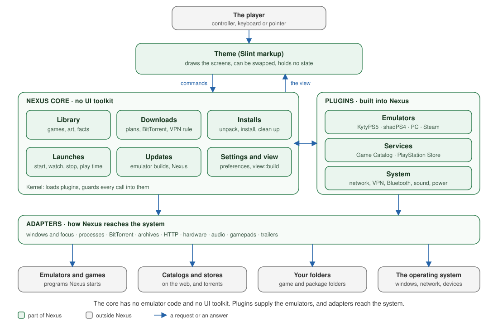
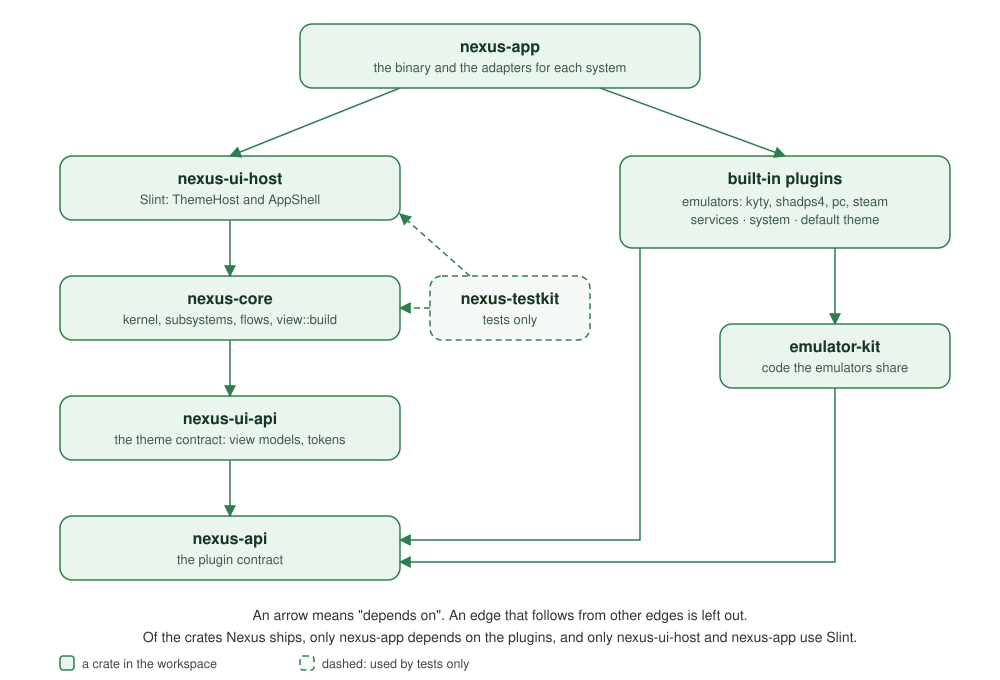

# Architecture

This page shows how Nexus is built: the crates, how data moves between them, what a plugin can
do, and what the app keeps on disk. It is for contributors, and for plugin and theme authors who
want the mental model first. Every name below is a name in the code; search for it.

- Writing a plugin: [plugins.md](plugins.md). Writing a theme: [themes.md](themes.md).
- Building, testing and releasing: [development.md](development.md).
- Windows, focus and controllers on each system: [reference/desktop.md](reference/desktop.md).
- Archives and PC games: [reference/archives-and-pc-games.md](reference/archives-and-pc-games.md).
- The words this page uses: [../GLOSSARY.md](../GLOSSARY.md).

## Overview

The overview: the player uses a theme, which sends commands to the Nexus core and draws the view the
core builds. The core works with plugins and reaches the system through adapters. The sections below
take each part in turn.

## Shape

Nexus is one binary built from crates in one Cargo workspace (`Cargo.toml`). The crate graph is
the boundary: a crate cannot use what it does not depend on. Inside the binary, a small kernel
loads plugins of four kinds: emulators, services, themes and system plugins.

The crate graph: nexus-app depends on nexus-ui-host and the built-in plugins, nexus-ui-host on
nexus-core, nexus-core on nexus-ui-api, and everything on nexus-api; the emulators also use
emulator-kit, and nexus-testkit serves the tests.

- `nexus-core` has no UI toolkit and no emulator code. Its view models are plain data.
- Only `nexus-ui-host` and `nexus-app` use Slint.
- Only `nexus-app` touches the system's own facilities: windows, BitTorrent, archives, Vulkan,
  libmpv, gamepads and audio. The core reaches them through ports (see [Ports](#ports)).
- The workspace denies `unsafe_code` (`[workspace.lints.rust]`). The few modules that allow it
  carry the reason on the same line, as an `allow(unsafe_code)` comment. Search for
  `allow(unsafe_code)` to list them.

### The crates

| Crate | Owns |
| --- | --- |
| `crates/nexus-api` | The plugin API: the plugin traits, `PluginManifest`, `Capability`, `Provided`, `PluginContext` with its facades, `RelPath` and `HostPath`, plans, slots, `Event`, `VpnGate`. Versioned by `API_VERSION`, which is set by hand. A manifest's `host_api` must include it. |
| `crates/nexus-ui-api` | The theme contract: the view models in `vm.rs` (`AppView` and its parts), `ThemeManifest`, the design tokens, and `contract/types.slint` with the `Vm` and `Host` globals. No toolkit code. |
| `crates/nexus-core` | The kernel and the app: `Kernel`, `EventBus`, `ConfigService`, the ports, `Core` and `Command`, `AppState`, the subsystems, the flows between them, and `view::build`. |
| `crates/nexus-ui-host` | `ThemeSet`, `ThemeHost` (compiles a theme with `slint-interpreter`, binds the view, swaps themes) and `AppShell` (routes the theme's requests, coalesces renders, loads images, runs the tick). |
| `crates/nexus-app` | The `nexus` binary: `main.rs`, the command line (`args.rs`), the launcher update (`update.rs`), and the adapters for each system. |
| `crates/nexus-testkit` | `FakeHost` (a real core over a temporary data folder), `FakeClock`, the fakes for the ports, `FakePlatform`, `StubPlugin`, `FakeCatalog`, `FakeStore`, `FakeService`, `FakeEmulator`, `ThemeDriver`, `SpanRecorder` and the capability contract checks. |
| `plugins/emulators/*` | `emu-kyty` (PS5), `emu-shadps4` (PS4), `emu-pc` (PC games), `emu-steam` (Steam games, Linux only). |
| `plugins/services/*` | `playstation-store` (store art and details) and `release-catalog` (the Game Catalog). |
| `plugins/system/host` | `system-host`, the system plugin with the id `system` ("This PC"). |
| `plugins/themes/default` | The built-in theme `default`. A crate only so the binary embeds its files. |
| `plugins/shared/emulator-kit` | Code the emulators share. A library, not a plugin. |
| `tests/` | The seam tests, in the crate `nexus-tests`. |

A plugin's id, not its folder or crate, names its data folder and its saved settings.

## Threads

The core runs on a multi-threaded tokio runtime. The UI runs on the main thread, in Slint's event
loop, where `AppShell` owns the `ThemeHost`. The two meet in two places:

- A theme callback becomes a `UiRequest`. The shell queues it and carries it out on its next
  `poll`, so a request never runs inside the callback that made it. The shell gives core
  commands and image loads to `Platform::spawn`, which the app runs on the runtime.
- Core events, finished work, gamepad presses and trailer frames return to the UI thread through
  `slint_interpreter::invoke_from_event_loop`, in `nexus-app/src/main.rs` and `platform.rs`.

The shell has no timer of its own. It reads the time from the core's `Clock` port and asks the
platform to call `poll` again with `Platform::wake_in`. The app also calls `AppShell::on_tick`
every `TICK` (250 ms) with a Slint timer. The UI thread's state lives in a thread-local in
`main.rs`.

## Data flows one way

The flow: a theme sends a command, the core changes its state and signals a change, the shell
renders, and the view builds from one snapshot and binds back into the theme.

1. A theme calls a `Host` callback. `Host.command(name, args)` carries a core `Command`: the
   variant name, and the payload as JSON. `ThemeHost` reads it with `serde`, with no code for
   each command. The other callbacks are things only the app can do (switch theme, play a
   sound, open a link or path, quit, restart, log out, the trailer, render).
2. `Core::dispatch` sends the command to the subsystem or flow that owns it.
3. A change calls `Core::changed(area)`, or a subsystem calls its `Notifier`. That sends a
   `Change { area }` on `Core::changes()` and publishes `Event::StateChanged` on the `EventBus`
   (a `tokio::sync::broadcast` channel; a reader that falls behind skips the oldest events).
   Plugins see neither the change nor its area.
4. `main.rs` reads every event from `core.events()` and calls `AppShell::on_core_changed`. An
   atomic flag keeps at most one event waiting on the UI thread.
5. The shell renders at most once per `RENDER_GAP` (8 ms). A burst of events renders once. Each
   render starts the image loads it needs. A cover that arrives later renders on its own, at
   most every `IMAGES_GAP` (100 ms), with `ThemeHost::render_images`.
6. `ThemeHost::render` calls `Core::view`. That takes a `Snapshot` and runs `view::build` over
   it, which returns an `AppView`. `bind::vm_values` turns it into Slint values with one `serde`
   converter (`values.rs`): each field becomes a `Vm` property of the same name in kebab case.
   Lists change in place where the rows allow it, so row animations do not restart.

A theme holds no state. A theme switch loses nothing: the new view tree binds to the same
`AppView`.

The tick also renders when the window size changes, the clock's minute turns, a trailer is open,
the boot screen waits for Home's art, or every `PLAYING_GAP` (15 s) while a game runs. It moves
the window to its monitor, writes `window shown` to the standard output once, makes the window
show under Gamescope, and in dev mode (`--dev`) reloads edited theme files.

## Plugins

### Kinds

`crates/nexus-api/src/plugin.rs` has one root trait and two kinds of code:

- `Plugin` has `manifest()` and `shutdown()`. Every plugin has them.
- `CodePlugin: Plugin` adds `init(ctx) -> Provided`. Emulators, services and system plugins
  implement it.
- `ThemePlugin: Plugin` adds `files()` and no code. A theme has no `init`.

The manifest `kind` (`emulator`, `service`, `theme`, `system`) says what a plugin is for. It
governs privileges only ([ADR 0001](adr/0001-capabilities-follow-the-capability-not-the-kind.md)):
only a `system` plugin may declare the system capabilities or run programs for long
(`Programs::stream`). Any plugin with code may provide the data capabilities. A theme declares
only `theme`.

Built-in plugins register at compile time with `inventory`: `PluginFactory::code` or `::theme`.
A crate registers only if it is linked, which is why `nexus-app/src/main.rs` names each plugin
crate (`use emu_kyty as _;`).

### Capabilities

Each extension point is one trait. A plugin implements the ones it has and returns them in
`Provided`. `init` must provide exactly the capabilities the manifest declares, or the plugin
fails with `LoadError::CapabilityMismatch`. The table is read from the built-in `plugin.toml`
files.

| Capability | Trait | Declared by |
| --- | --- | --- |
| `catalog` | `Catalog` (the installed games) | `emu-kyty`, `emu-shadps4`, `emu-pc`, `emu-steam` |
| `downloader` | `Downloader` (plans emulator downloads) | `emu-kyty`, `emu-shadps4` |
| `installer` | `Installer` (installs builds) | `emu-kyty`, `emu-shadps4` |
| `configurator` | `Configurator` (settings schemas) | `emu-kyty`, `emu-shadps4`, `emu-pc`, `release-catalog` |
| `launcher` | `Launcher` (`prepare` a `LaunchSpec`) | all four emulators |
| `compatibility` | `Compatibility` | `emu-kyty`, `emu-shadps4` |
| `game_installer` | `GameInstaller` | `emu-kyty`, `emu-shadps4`, `emu-pc` |
| `slots` | `Slots` (badges, actions, sections as data) | all four emulators, `release-catalog` |
| `releases` | `Releases` (what the Catalog offers) | `emu-steam`, `release-catalog` |
| `metadata` | `Metadata` (store art and details) | `emu-steam`, `playstation-store` |
| `theme` | `ThemePlugin::files` | themes only |
| `network`, `vpn`, `bluetooth`, `audio`, `power` | `NetworkSettings`, `VpnSettings`, `BluetoothSettings`, `AudioSettings`, `PowerSettings` | `system` |
| `os_updates`, `os_install` | `OsUpdates`, `OsInstall` | `system` |

The core joins answers across plugins only through these traits: one library from every
`Catalog`, one Catalog from every `Releases`.

A `Release` holds the fields the core sorts, groups, searches and downloads by. What the catalog
only shows is `facts` (`Fact`, with a typed `FactKind`). A game's store data is `metadata`, and
why a release may not install is `install_warning`. A precondition the host knows is typed, and
the core words it for the player: `PluginError::OwnBuildMissing` names the emulator's page.

### The manifest

Every plugin has a manifest: `plugin.toml`, or `theme.toml` for a theme. `PluginManifest`
(`crates/nexus-api/src/manifest.rs`) holds `id`, `kind`, `name`, `version`, `host_api`,
`platforms`, `capabilities`, `permissions`, `dependencies`, `activation` and `runtime`. An
emulator adds `console`, `emulator`, `requires`, `[[keymap]]` and `install_note`. Sections for
one kind, such as `[theme]`, stay in `extra`, and the crate that owns them reads them.

### Where plugins come from

`KernelBuilder` collects candidates from two places:

- `built_in_plugins()`: every `PluginFactory` linked into the binary (`Origin::BuiltIn`).
- `discover(dir)`: each subfolder of `dir` that holds a `plugin.toml` or `theme.toml`
  (`Origin::ThirdParty`). The app discovers `<data-dir>/extensions`, or `--extensions`, and the
  `extensions` folder beside the binary (`args::bundled_extensions`).

Nexus has no runtime for third-party code. A plugin found on disk must have
`runtime = { type = "data" }`, and the only `Loader` is `DataThemeLoader`, so a third-party
plugin is a data-only theme.

### Lifecycle

`Kernel::boot` (`crates/nexus-core/src/kernel.rs`) runs these steps:

1. **Validate** each candidate: the manifest reads, `host_api` includes `API_VERSION`, safe
   mode rejects third-party plugins, the folder grant names are legal, the kind rules hold, and
   no id repeats. A theme for another system is rejected. An emulator or service for another
   system loads, but turned off, with a warning.
2. **Resolve** the load order with `petgraph` (`resolve.rs`): `tarjan_scc` finds cycles and
   names each member, and `toposort` orders the rest. A theme's `extends` counts as a
   dependency. A plugin with a missing, rejected or wrong-version dependency is rejected.
3. **Load**: a built-in plugin is already code; a folder goes to a `Loader`. A theme manifest
   with code, or a code manifest with a theme, is rejected.
4. **Init** the `eager` plugins (the default theme, which has no `init`). Others init on the
   first `Kernel::provided` call. Dependencies init first.
5. **Deactivate**: `Kernel::deactivate` deactivates dependents first, then calls `shutdown`
   under `shutdown_timeout`, at most once for each activation. `Kernel::shutdown` does this for
   every plugin in reverse load order.

Failures go into the `BootReport` and the log. Boot carries on without them. A plugin whose
`init` fails is `PluginStatus::Failed` for the rest of the run and is not retried.

### Turned on and off

`Kernel::enabled` reads two lists in `config.json`. A plugin is on unless its id is in
`app.disabled_plugins`. A plugin made for another system is off unless its id is in
`app.enabled_plugins`. `Command::SetPluginEnabled` edits the right list. A theme cannot be turned
off, and an emulator cannot be turned off while `emulator_builds::busy` says an install or update
is under way. A plugin that is off is left out of `Kernel::providers` and `Kernel::of_kind`, and
`Kernel::provided` refuses it. It stays listed, and turning it on needs no restart. With no
`Releases` plugin on, there is no Catalog.

### The context and permissions

`init` gets a `PluginContext` from `Kernel::context_for`. Each part is scoped to the plugin:

- `config`: the plugin's settings, under `plugins.<id>.<scope>` in `config.json`. The scope is
  `emulator` or `game:<game key>`.
- `storage`: the plugin's own folder, `plugins/<id>/` in the data folder (`DirStorage`). A
  `RelPath` has no `.` or `..` parts, and a symlink that leads out is refused.
- `folders`: named host folders (`HostFolders`, `folders.rs`). A manifest asks for names in
  `permissions.filesystem`. The player maps each name to real folders, saved under
  `app.folders.<name>`; until then the grant's default applies. A plugin addresses a file with
  a `HostPath` (folder name, root index, `RelPath`). The host refuses a name the manifest did not
  ask for, a write without `write = true`, and a symlink out of a root. The names `games` and
  `packages` are shared by every plugin and shown once in Settings.
- `programs`: find and briefly run the programs `permissions.process` allows, for at most
  `MAX_PROGRAM_TIME` and `MAX_PROGRAM_OUTPUT` of output.
- `http`: HTTP limited to `permissions.network`. The transport never follows a redirect; the core
  follows it and checks every hop (`facades::send_checked`).
- `log`: tracing, tagged with `plugin_id`.
- `events`: subscribe to every `Event`; publish only `Event::Custom`.
- `services`: a `ServiceRegistry` with `HostInfo` and the `VpnGate`.

Plugins never reach each other.

### The guard

Every call into a plugin goes through `Kernel::guard` (`guard.rs`). It opens a `plugin_call`
tracing span with `plugin_id` and `method`, applies a timeout (`call_timeout`) on the kernel's
clock, and catches a panic. A panic becomes `PluginError::Panicked`, a timeout
`PluginError::Timeout`, and the caller gets a `CoreError::Plugin`, usually shown as a notice.
Only a failed `init` marks a plugin failed. The timeout fires at the plugin's next `.await`:
code that blocks its thread without awaiting holds that worker thread.

## Ports

The core reaches the system through traits in `crates/nexus-core/src/ports.rs`. `KernelBuilder`
starts with a stand-in for each port, the app plugs in the real one, and the test kit has a fake.

| Port | Stand-in | App adapter | Test fake |
| --- | --- | --- | --- |
| `HttpTransport` | `NoNetwork` | `http::ReqwestTransport` | `FakeHttp` |
| `ProcessSpawner` | `TokioSpawner` | `TokioSpawner` | `FakeSpawner` |
| `ProcessTree` | `GroupTree` | `processes::SystemProcesses` | `FakeProcessTree` |
| `Windows` | `NoWindows` | `desktop::SystemWindows` | `FakeWindows` |
| `LoginSession` | `NoLoginSession` | `desktop::SystemLoginSession` | `FakeLoginSession` |
| `Opener` | `NoOpener` | `desktop::SystemOpener` | `FakeOpener` |
| `Hardware` | `NoHardware` | `hardware::SystemHardware` | `FakeHost` (`hardware`, `free_space`) |
| `Torrents` | `NoTorrents` | `torrents::RqbitTorrents` | `FakeTorrents` |
| `Network` (VPNs) | `NoVpn` | none: a system plugin's `vpn` replaces it | `FakeNetwork` |
| `Archives` | `NoArchives` | `archives::HostArchives` | `FakeArchives` |
| `Clock` | `TokioClock` | `TokioClock` | `FakeClock` |

`TokioSpawner` and `GroupTree` are real adapters, so they live in `process.rs`, not in
`ports.rs`.

Boot builds the ports once into one bundle, `Ports`, and makes the VPN rule over the `Network`
port. `Core::start` splits the bundle for each subsystem (`Ports::torrents()`, `sessions()`,
`preferences()`, `installs(..)`, `launcher_update()`, `downloads()`), so each subsystem gets only
the ports it names. The kernel has no getter for a single port.

- `TokioSpawner` starts each game as the leader of its own process group on Unix. On Windows
  the group is the process and its children. `terminate` asks it to close; `kill` ends the
  group.
- `ProcessTree` lists a running game's processes (`members`): the process the launcher started,
  its process group, and what a sandbox moved out of the group. `end` closes or kills them, and
  `find(text)` finds the processes with that text in their command line (Unix only).
- `Windows` says which window is in front, brings the game's window or the launcher's up, and
  answers `has_window`, `window_close_ends_game` and `problem`.
- `LoginSession` starts the launcher at login and installs the launcher's own package with
  the administrator prompt.
- `Opener` opens a link or a path with the system's opener.
- `Torrents` is raw: `start`, `unpause`, `stop` and `stats`. The meaning of the numbers is the
  core's phase rules (`torrents/phase.rs`), so the adapter and the fake decide nothing.
- `Hardware::specs` is slow, because it runs system tools. The core calls it once a run, off the
  async threads. `free_bytes` gives a disk's free space.
- `Archives` has one call, `unpack`. The adapter lists an archive, then hands the listing to the
  core's archive plan (`plan_unpack` in `archive_plan.rs`). The plan refuses passwords, paths and
  links that leave the folder, and archives bigger than the free space. The adapter writes only
  what the plan holds. See [reference/archives-and-pc-games.md](reference/archives-and-pc-games.md).
- `Clock` is the core's time: `now`, `sleep` and `interval`. Every timer of the core runs on it.
  No other code in `nexus-core` uses `tokio::time`. `TokioSpawner` runs real programs, so it
  keeps real time whatever clock the kernel has.

The app shell has a port of its own, `Platform` (`nexus-ui-host/src/shell.rs`). It runs work off
the UI thread, wakes the shell, opens links and paths, quits and restarts, writes the lines the
Nexus session reads, plays sounds and trailers, reads the local time, and asks the window system
about monitors and focus. The app plugs in `platform::SystemPlatform`. Tests plug in
`FakePlatform`, which records each call and runs work only when the test says.

## The core

### Subsystems

`Core` (`app.rs`) is a router. It starts the subsystems, sends each command to its owner, merges
their changes into `Core::changes()`, and reads them all into one `Snapshot`. The subsystems are
the torrents (`torrents/`), the game installs (`game_installs/`), the library (`library/`), the
running games (`sessions/`), the preferences (`preferences.rs`), the notices (`notices.rs`), the
VPN setting (`vpn.rs`) and the launcher's update (`launcher_update.rs`). A subsystem follows
these rules:

- It owns its state behind its own lock, and its saved records. Nothing else takes that lock or
  writes those keys.
- It takes only the ports it needs, never the `Kernel` or the `Core`.
- The core sends it commands (`handle(...)`) and reads it whole (`snapshot()`). A read changes
  nothing. `Command` nests each subsystem's commands, such as `Command::Torrent(TorrentCmd)`.
- It publishes its changes with its area through a `Notifier`.
- What other areas must do about a change goes out as events (`TorrentEvent`, `InstallEvent`),
  which the core turns into work. A subsystem never calls into the core.
- A command that needs another area first is resolved by the core, which hands the subsystem
  plain data (`add(NewDownload)`, `begin(NewInstall)`).
- A snapshot that the view reads on every render shares its data through `Arc`.
- A subsystem never calls out while it holds its lock, and the core takes a subsystem's lock
  only when it does not hold `AppState`.

What no subsystem owns stays in `AppState` (`app_state.rs`), behind one mutex in `Core`:
navigation (`nav`, a stack of `Route`), the selections and the grids, the install prompt, the
result prompt, each emulator's builds, the Settings panels, the machine's state, the stores'
installs and the theme on screen.

Work that crosses areas is a flow: a free function over the core, in its own module.
`navigation.rs` moves the player between screens. `emulator_builds.rs` installs, updates and
removes builds. `plugin_settings.rs` sets plugin settings and turns plugins on or off.
`release_downloads.rs` resolves the Catalog's downloads and installs. `launch.rs` starts games and
handles their end. `library_reads.rs` and `catalog_reads.rs` read the plugins for the library and
the catalogs. `uninstall.rs` removes an installed game. `system.rs` runs the machine's
settings. The commands keep flat names (`Command::Back`, `Command::LibrarySort`), which the themes
send. [ADR 0002](adr/0002-game-page-reads-stay-as-flows.md) records why the reads for a game's page
stay separate flows.

### Preferences

Each of the app's one-value settings is a `Pref`, saved as `app.<key>`. A `Pref`'s spec says
what values it takes, its default, and whether the player sets it. `Command::Pref(Pref, Value)`
checks the value against the spec: a size goes to the nearest end of its range, and a value of
the wrong type is refused. "Start at login" asks the `LoginSession` port first. The config is the
subsystem's store, so a setting cannot drift from what is saved. The keys are `sounds`,
`fullscreen`, `return_on_exit`, `scale`, `start_at_login`, `auto_update`, `monitor`, `welcomed`,
`theme` and `pc_noticed`.

### Host folders

`HostFolders::place` (`folders.rs`) decides which folder a console's downloads and installs use.
The caller names a `Purpose` (`Download` or `Install`) and a console. `place` returns the
console's folder: the folder the player chose, else the one last picked for the console, else
`<console>` in the first folder of the grant. The grant is `packages` for a download and `games`
for an install. The last pick is saved under `app.download_folder.<console>` or
`app.install_folder.<console>`, and a pick that is in no grant folder any more reads as none. A
chosen folder must lie inside one of the plugin's grant folders. `HostFolders::remember` saves a
pick after the caller has checked the free space. `Kernel::host_folders` makes the `HostFolders`
of a plugin, for the plugin's context and for the core. The unit tests in `folders.rs` pin these
rules.

### Downloads and torrents

There are two download paths.

**Plans (emulator builds).** A `Downloader` returns a `DownloadPlan`: artifacts with a URL, a
SHA-256, an optional detached `Signature`, a destination in the plugin's folder, and an optional
`Unpack`. `Downloads` (`downloads.rs`) is one long-lived task fed by a channel (submit, pause,
resume, cancel). It runs `max_downloads` jobs at once and queues the rest. Each file goes to
`<dest>.part` and resumes with a Range request. It moves into place only after its hash and
signature match. Running downloads are saved under `app.downloads`, and installs under
`app.installs.<plugin>`, so both resume after a crash.

**Torrents (Catalog releases).** The torrents subsystem drives the `Torrents` port. A download
starts only from the player (`Command::Torrent(TorrentCmd::Download)`). The core resolves the
release and the folder first (`release_downloads.rs`), then adds the download. A download is in
one of these states (`TorrentState`): Resolving, Ready, Checking, Downloading, Paused, Complete,
Failed and Cancelled. Files go to `<folder>/torrent-<info hash>`. Each download is saved under
`app.torrents.<info hash>` (`torrents/records.rs`); after a restart, unfinished downloads come
back paused. A finished download seeds while `app.seed_downloads` is on, at most
`SEED_UPLOAD_LIMIT`. One task (`TorrentsSubsystem::watch`) reads the running torrents' stats
every `torrent_poll` while any run. `phase::next` turns each reading into the download's next
phase and a list of actions. A finished download goes to the core as an event, which has the game
installs unpack its archives and posts a notice.

The app's adapter (`crates/nexus-app/src/torrents.rs`) uses librqbit: one session, made at the
first use, with no local peer discovery, at most 50 peers, the upload cap, and JSON persistence
with fastresume in `torrents/resume/`.

**Unpack.** When a download completes, the core finds its archive sets (`archives.rs`) and the
game installs unpack them through the `Archives` port into `unpacked/<folder>/<name>/` in the
download, through a `.part` folder. The unpack state is saved with the download.

### Game installs

A `GameInstaller` decodes a package. The game installs subsystem owns the job
(`game_installs/`). Its ports are `Archives`, `Hardware`, `Clock` and `TorrentDownloads` (the
downloads' records and their hand-off). The core resolves the plugin's installer and folders and
hands them over. `GameInstaller::begin(source, job)` checks the source and returns a work folder
at once. The plugin then writes in the background through its `Folders` and reports through the
`InstallJob`: `progress`, `cancelled`, `finished` (exactly once; on an error the work folder must
be gone), `games_folder` and `take(from, to)`. If the plugin drops the job without finishing, the
job fails. The subsystem tells the core what to do with `InstallEvent`s, and waits for each: the
library refreshes before a job shows as done, and a failure's notice is up before the job shows
it. Work folders are saved under `app.game_installs`, and one a crash left is removed at the next
start (`GameInstallsSubsystem::clean_up`).

### Launches and the game watcher

The sessions subsystem (`sessions/`) owns the running games: their sessions, `game_in_front`,
the one-game-at-a-time claim, Stop, the window focus calls and the play time (`app.playtime`).
`Command::Session(SessionCmd)` carries `Launch`, `Stop`, `ShowGame` and `ToggleFocus`.

A launch needs the plugin first, so the core resolves it (`launch.rs`):

1. `SessionsSubsystem::claim`: one game at a time. No game starts while `emulator_builds::busy`
   says its emulator installs or updates.
2. A first play whose emulator is not installed asks the player first (`ask_to_install`).
3. `Launcher::prepare` returns a `LaunchSpec`, or a precondition the Game Hub shows.
4. The program must pass `permissions.process`. The core resolves the paths and hands the
   subsystem a `NewSession`.
5. The subsystem spawns the process with its output in the game's log, adds a `Session` and
   publishes `Event::ProcessStarted`. The core opens the Running screen.

The watch (`sessions/watch.rs`) follows the session until it ends. A game is its processes, as
`ProcessTree::members` lists them, and it ends when none is left. Until the game has a window or
`show_timeout` passes, the watch tries `show_game` every `SHOW_EVERY`. After that it reads `front`
and `has_window` every `watch_every`. On a system where `window_close_ends_game` is true (macOS),
a window that was seen and is gone for `WINDOW_GONE_FOR` reads in a row stops the game.

A launch can hand the game to another program: `LaunchSpec.game_process` holds words of the game's
own command line. The program started here is then left alone, and the watch looks for the game
with `ProcessTree::find` until `hand_over_timeout`. A game that never shows ends the session with
a notice and no play time. Stop asks the game's processes to close, waits `stop_grace`, and kills
what is left.

When the game exits, the core's `finish` (`launch.rs`) ends the session, then applies one pure
rule, `sessions::outcome` (`sessions/ending.rs`). The rule decides the notice the ending earns:
none for a game the player stopped, a "didn't start" notice for a game that never showed, and a
crash notice with the log for any other failed exit. It also decides whether the core asks "How
far did it get?", once for each build. `finish` then brings the launcher back when "Back to the
launcher" is on, calls `Launcher::on_exit`, publishes `Event::ProcessExited`, and runs an emulator
update that waited for the game.

### Library, metadata and catalogs

The library subsystem (`library/`) holds one `GameRecord` per game key: the game as its plugin
lists it, its badges and details (`DetailState`), what a store said about it, and, for an
installed game, the Catalog offer it is. It also holds the catalogs' copies and the offers
grouped from them. It stores domain data, and `view.rs` turns that into view models. It asks no
plugin: the core's flows read the plugins and hand it the answers, because a read crosses areas.
It owns `app.hidden_games`, `app.game_art` and `app.results`.

`Command::Library(LibraryCmd::Refresh)` lists every `Catalog` plugin's games, sorts them by
title, reads their `game.badge` slots, and selects the first game. The first load is the boot:
it reads the emulators' builds and asks the `Metadata` plugins about the games. Later loads run in
the background. The core keeps what a `Metadata` plugin says in the game's record, and asks about
each game at most once a run.

A `Releases` plugin answers `releases(console)` for the console each turned-on emulator names;
only the first emulator for a console gets its catalog. `refresh_releases` (`catalog_reads.rs`)
asks every `Releases` plugin, groups the releases into offers (`releases::offers`), reads the
`catalog.action` slot, and posts a notice when releases were added. One read runs at a time.

The `release-catalog` service answers at once with the best copy it has: one fetched from its
catalog address, one refreshed from the forums, else the copy bundled from `assets/catalog/`. Its
modules are `topic.rs` (a typed model of a catalog file), `format.rs` (releases from a topic),
`store.rs` (`CopyStore`, the fetched and refreshed copies), `schedule.rs` (due times and back-off),
`sources.rs` and `lib.rs`. How the catalog files are made is in
[../scripts/catalog/README.md](../scripts/catalog/README.md).

### The machine's settings

`crates/nexus-core/src/system.rs`. For each system capability the core uses the first active
system plugin that provides it, calling it under the guard. `SystemState` holds the network and
Wi-Fi list, Bluetooth and its devices, the sound outputs and level, the battery, Nexus OS's
update and the stick's disks, each capability's unavailability reason, and the jobs. `refresh`
reads it all every `REFRESH_EVERY` while a system plugin is on, and after each
`Command::System` action. A job (`HostJob`) stays listed for `JOB_KEPT` so the theme can say how
it ended. `Place` says whether Nexus is the whole screen, on Nexus OS, or on its USB stick; see
[nexus-os.md](nexus-os.md).

### Downloads only through a VPN

`vpn.rs` holds the rule (`VpnRule`) and the VPN subsystem (`VpnSubsystem`). The rule reads
`app.vpn_only` and `app.vpn`, holds the `Network` port, and notes when a plugin waits. Boot makes
the rule before any plugin starts. The kernel gives it to each plugin as its `VpnGate`. While
`app.vpn_only` is on, the torrents subsystem binds the torrent port to the VPN's interface
(`Torrents::route`) before a download talks to the swarm. Without that VPN a download waits
(`waiting_vpn`).

The kill switch runs in the torrents' watch task: it checks the VPN every `vpn_poll`. When the VPN
drops or changes, every running download pauses and is marked waiting, and `Torrents::stop_all`
closes the connections. When a VPN is back, the port is rebound and only the waiting downloads
start again. A plugin sees the rule through `VpnGate::check`, which says only whether the VPN is
up. A plugin's HTTP does not go through the VPN.

### The launcher's update

`launcher_update.rs`. On `LauncherUpdateCmd::Check`, the subsystem reads `latest.json` from the
latest release of `app.update_repo` and follows redirects only to GitHub's hosts. A higher
version is an update. `LauncherUpdateCmd::Download` downloads the package for this kind of
install (`Install::detect`), checks its SHA-256, and keeps it in `updates/` with `ready.json`, or
hands it to the package manager for a deb, rpm or Arch install. At the next start, `main` calls
`apply_launcher_update` (`nexus-app/src/update.rs`), which swaps a kept update in, puts the old
one back on failure, and starts the new binary. Emulator updates are separate:
`schedule_update_checks` runs `check_updates` after `FIRST_UPDATE_CHECK` and then every
`UPDATE_CHECK_EVERY` while "Update automatically" is on. An emulator whose game runs updates after
the game closes. An own build never updates by itself.

## The view

`Core::view` builds the `AppView` in two parts:

1. `Core::snapshot()` reads everything once: each subsystem's snapshot, a copy of `AppState`, the
   plugins' manifests with which are on, the theme's option values, the time by the core's clock,
   and what the view needs from the disk (`Files`: which games' folders exist, the Game Hub
   game's log, the downloads' install folders, the host folders' paths).
2. `view::build(&Snapshot)` turns that into view models. It takes no lock, does no I/O and keeps
   no state.

Display text (sizes, dates, durations) is built in the core, in `display.rs`, when the view is
built. The view's rules live in pure modules over the snapshot, each with its own tests:

- `ownership.rs` (`Ownership`): which installed game a Catalog offer is, the release an offer's
  card shows, and the game Play starts.
- `grid_query.rs` (`GridQuery`): a grid's search, filters, sort and pages.
- `settings_schema.rs`: a plugin's JSON Schema read as the fields a panel shows.
- `disks.rs` (`Disks`): each console's download folder and the free space there, read ahead so
  the view never asks the disk.
- `game_words.rs`: the words on a game's page. `words` takes the game's own description,
  developer and genres first and fills what they leave out from the layers of store data.
  `home_line` is Home's line for a game.
- `releases.rs` (`ordered`): the releases of an offer in the order the Game Hub lists them, with
  each one's "Version N of M" label.

## Themes

A theme owns presentation: layout, navigation, components, tokens, assets, motion and sound. The
contract is in `crates/nexus-ui-api`:

- `contract/types.slint` holds the `Vm` global (the `AppView` field for field), the `Host`
  global and the `Json` helpers. It is written by hand. A drift test in `nexus-ui-host` fails
  when it and the view models name other fields. The host serves it; a theme never ships a copy.
- Screens (`ScreenId`) and components (`ComponentId`) are one file and one exported component
  each. The root is `shell.slint`, exporting `Shell`.
- `contract::lint` refuses `@image-url` and font imports before compiling. Images and fonts are
  declared in `theme.toml` and reach the theme through `Assets` and `Tokens`.

`ThemeSet` builds the `extends` chain up to `default`, which has every screen, component and
token. Imports resolve in the theme first, then each parent. Tokens, images, fonts, sounds and
options merge, the child winning.

`ThemeHost` compiles with `slint-interpreter` (`compile.rs`). The compiler's file loader serves
only a virtual folder (`VFS_ROOT`) and refuses a path outside it, so markup cannot read the disk.
`ThemeHost::switch` loads the theme, decodes its assets, compiles it, creates the new tree in the
same window, binds tokens, options, assets and the view, saves the choice, shows it, and only
then drops the old one. Any failure keeps the old theme. A switch asked for from a theme callback
runs on a zero-delay timer, because the switch drops the tree that runs the callback. At start,
`start_with` falls back to `default` if the chosen theme fails; safe mode shows only `default`.

Gamepads: `gamepad.rs` reads controllers with `gilrs` on its own thread and repeats a held button.
`PadButton::action` (`input.rs`) maps each button to a key the theme already handles. `Vm.pad-key`
is true while that key is delivered, so a theme can tell a controller's keys from a keyboard's.
While a game's window is in front, or the launcher's window does not have focus, `ThemeHost`
drops every pad button but a hold of the PS (Guide) button, which stops each running game.

## What persists

Everything lives in one data folder: `$XDG_DATA_HOME/nexus` (or `~/.local/share/nexus`) on
Linux, `~/Library/Application Support/nexus` on macOS, `%APPDATA%\nexus` on Windows. `--data-dir`
picks another.

| Path | What |
| --- | --- |
| `config.json` | All settings: the app's under `app`, each plugin's under `plugins.<id>.<scope>`. Written on every change, through a temporary file and a rename. |
| `plugins/<id>/` | Each plugin's `Storage`: emulator builds, caches, the release catalog's copies. |
| `logs/<plugin>/<game>.log` | A running game's output. The run before stays as `<game>.previous.log`. |
| `cache/net/` | Images fetched by URL, named by the SHA-256 of the URL. |
| `cache/thumbs/` | Smaller JPEG copies of art, at card and full-screen size. Other files there are removed at start. |
| `torrents/` | Each torrent's metadata, and `resume/` with librqbit's fastresume data. |
| `updates/` | A downloaded launcher update and its `ready.json`. |
| `extensions/` | Third-party themes, unless `--extensions` names another folder. |

The keys the core keeps under `app` include `folders`, `downloads`, `installs`, `game_installs`,
`torrents`, `seed_downloads`, `playtime`, `results`, `hidden_games`, `game_art`, `vpn_only`,
`vpn`, `update_repo`, `disabled_plugins` and `enabled_plugins`, plus the preferences. Downloaded
games are not in the data folder: they go to the player's `packages` folders and are installed
into the `games` folders.

## Startup and shutdown

`crates/nexus-app/src/main.rs`, in order:

1. Tracing starts. `--supports <feature>` and `--probe-gpu` (the Vulkan probe's child process)
   answer and exit.
2. The arguments parse (`args.rs`). `apply_launcher_update` swaps in a kept update, if there is
   one.
3. A tokio runtime starts. `Kernel::builder` gets the ports, `built_in_plugins()` and the two
   `discover` folders, and calls `boot()`.
4. `Core::start` splits the ports for the subsystems, starts them, builds the `AppState`, and
   starts the background work: the download manager, the clean-up of work folders a crash left,
   the restore of saved torrents, the resume of installs and plan downloads, the emulator update
   checks, the hardware read and the catalog watch.
5. `--folder` mappings apply as `Command::SetFolders`. `quit_on_signal` is spawned.
6. `AppShell::new` makes the `ThemeHost`. `start_with` shows the chosen theme or `default`.
7. The old thumbnails are swept, and the gamepad thread, the core event task and the tick start.
8. `Command::Library(LibraryCmd::Refresh)` is dispatched, the first render runs, and Slint's event
   loop runs.

The event loop ends on Quit, Restart or a signal: Ctrl-C, SIGTERM and SIGHUP quit as the Quit
button does, and a second signal exits at once. Then the timer and the UI state are dropped and
`Core::shutdown` runs, for at most `SHUTDOWN_LIMIT` (10 s), while the runtime still runs. It
first calls `Torrents::stop_all`, so each torrent writes down the pieces it has, then
`Kernel::shutdown`. After a Restart, the launcher starts again with the same arguments.

## Performance

These rules shape the code. Keep them when you change it.

- **One render for each frame.** A render rebuilds the whole `AppView`, so renders coalesce: one
  pending flag for core events, and `RENDER_GAP` between renders.
- **The Catalog grid builds only while it is on screen.** `Core::view` keeps the last grid in
  `AppState.catalog_grid`, and other screens reuse it.
- **One `Ownership` for each render.** Every card, grid and Game Hub asks the same one.
- **Free space is read ahead.** The view never asks the disk (`Disks`).
- **Images.** Only cards on or near the screen ask for art. The `ImageLoader` (`loader.rs`) limits
  the fetches and the decodes it runs at once, off the UI thread, and keeps smaller JPEGs in
  `cache/thumbs` (`THUMB_WIDTH` by `THUMB_HEIGHT` for cards, `MAX_WIDTH` for full screen).
- **Select settles.** `Command::Select` waits `SELECT_SETTLE` before it loads details, so
  scrolling past games loads nothing.
- **Long card lists change by row.** `bind::CardModels` keeps the card lists as last shown and
  replaces only the cards that changed.
- **Grids page.** The Library and Catalog grids grow `GRID_PAGE` games at a time.
- **Dev profile.** `[profile.dev]` builds the workspace at `opt-level = 1` and every dependency
  at `opt-level = 2`.

## Tests

The tests have four seams, from the highest:

1. **The core's API**, through `FakeHost`: commands in; view models, events and errors out. The
   core runs on a `FakeClock`, tokio's time paused at boot. Time moves when a test calls
   `advance`, or when every task waits for a timer. A test waits for work with
   `TestCore::until(area, done)` or `FakeClock::run_until_idle`. No seam test sleeps.
2. **Capability contracts**: `nexus_testkit::contract::emulator`, run on the emulator plugins and
   on `FakeEmulator`.
3. **The composed host**: the core and the `AppShell` the app ships, on Slint's testing backend
   with `FakePlatform` and the core's `FakeClock`. A test drives the theme through `ThemeDriver`
   (accessible labels, keys, clicks) and checks the view through `core.view()`.
4. **The desktop adapter against real windows** (`crates/nexus-app/tests/desktop.rs`). It runs
   only with `NEXUS_DESKTOP_TESTS=1`.

Pure rules have table tests beside them: the torrent phase rules (`torrents/phase.rs`), the
folder rules (`folders.rs`), the words of a game's page (`game_words.rs`) and the meaning of a
game's end (`sessions/ending.rs`). `FakeTorrents` is a swarm simulator: it reports raw stats and
decides nothing, so the seam tests run the core's real phase rules. The env-gated tests are listed
in [development.md](development.md).
