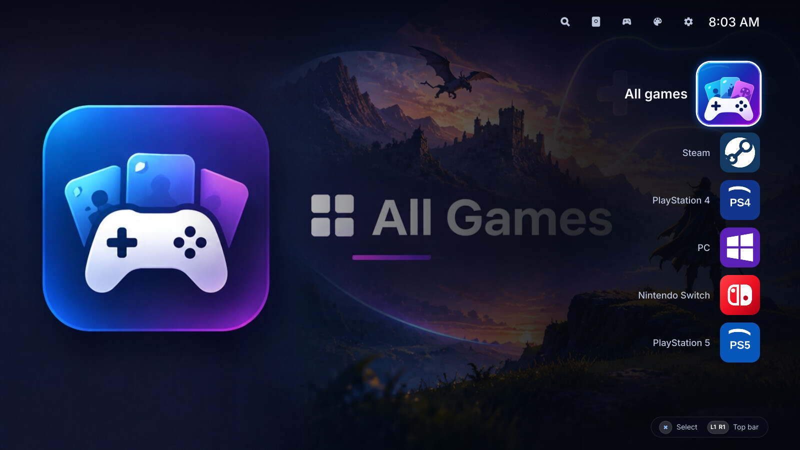
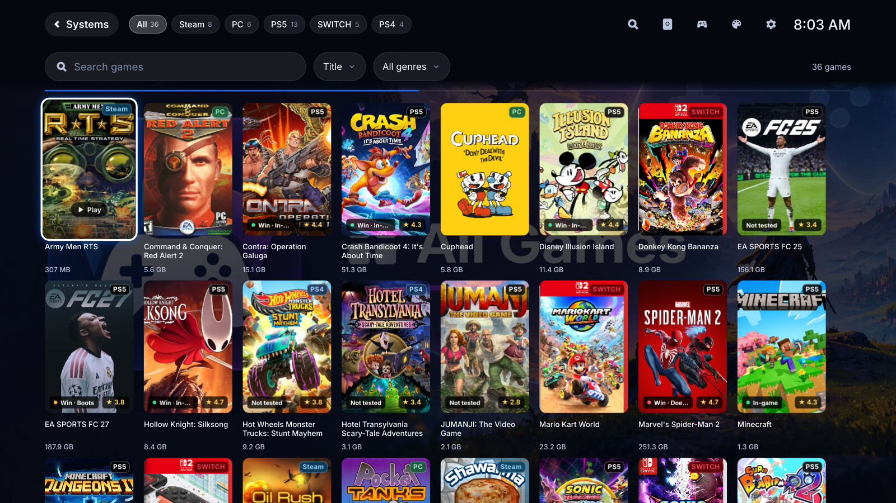
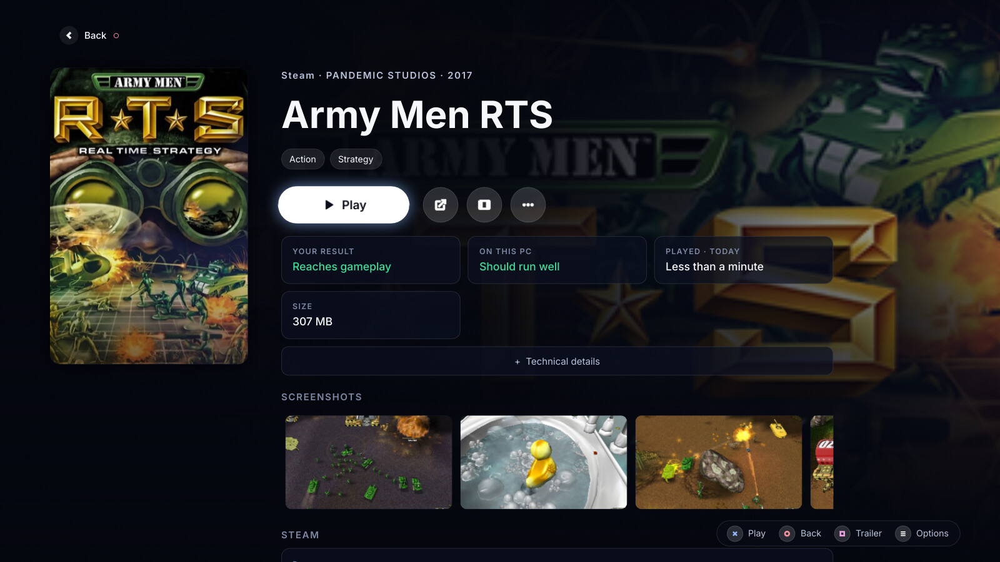
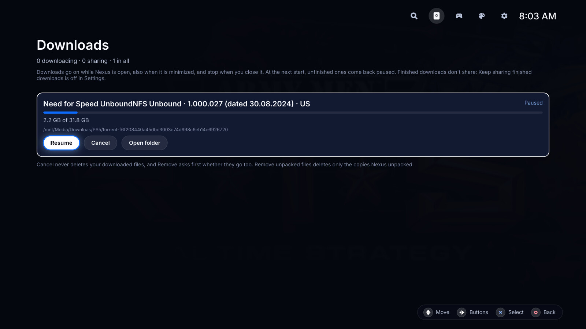
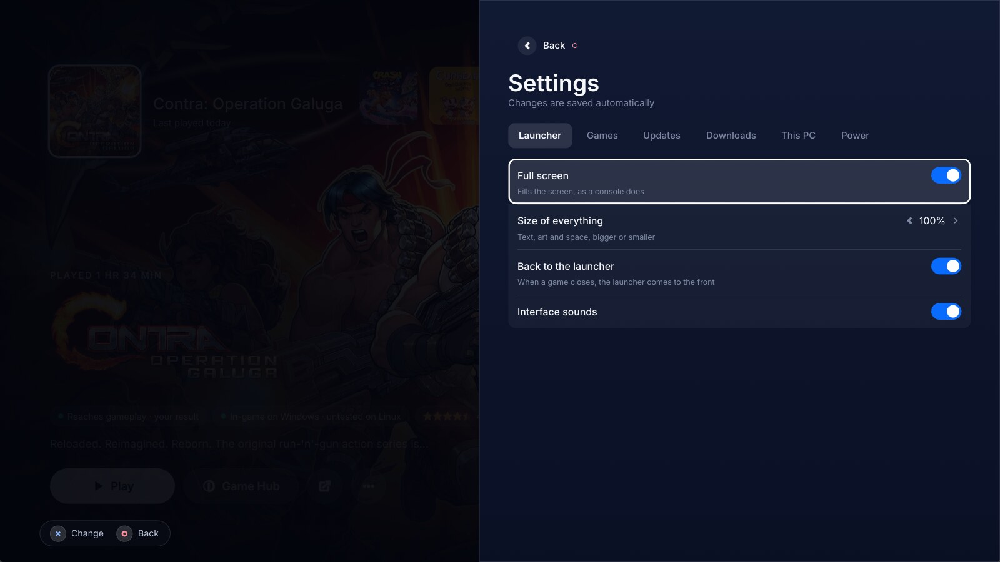
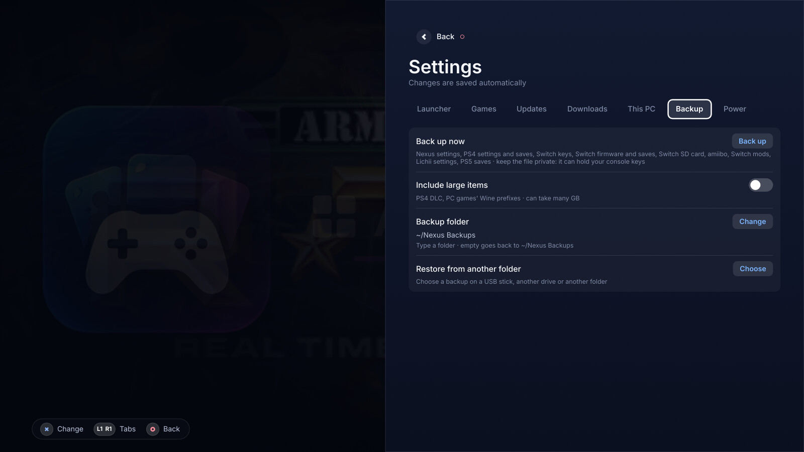
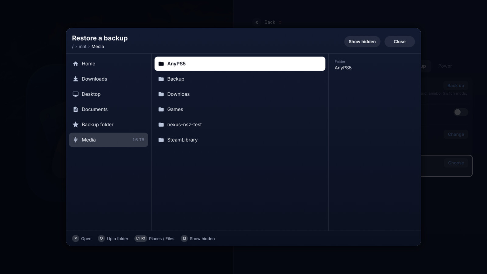

# User guide

This guide is for people who play with Nexus. It walks through each screen, the controller and
keyboard keys, backups, where Nexus keeps your data, and what to do when something goes wrong.
To install Nexus, start at the [README](../README.md).

The guide shows the Default theme. The Classic theme has other layouts for Home and the
Library, but the same keys and the same other screens: see
[reference/classic-theme.md](reference/classic-theme.md).

## First start

Nexus opens full screen. On the first start, a Welcome screen lists what Nexus sets up: your
game folders, each emulator, official artwork and details, and the covers. Press ✕ (Enter) on
**Start** when it is ready.

Nexus looks for games in `~/Games` and for packages to install in `~/Downloads`. To change the
folders, go to Settings → Games.

## Keys

Every screen works with a controller, a keyboard or a mouse. The table names the PlayStation
buttons. On an Xbox controller, ✕ is A and ○ is B.

| Controller | Keyboard | What it does |
| --- | --- | --- |
| D-pad, left stick | Arrow keys | Move |
| ✕ (Cross) | Enter | Select |
| ○ (Circle) | Escape or Backspace | Back |
| △ (Triangle) | `/` | Search. On the Catalog it searches the Catalog, elsewhere the Library. |
| □ (Square) | T or Insert | The shown game's trailer |
| Options | Menu | The shown game's menu. On Home, the focused system's emulator page. |
| L1, R1 | Shift+Tab, Tab | See below |
| L2, R2 | Page Up, Page Down | A page up or down |
| Create (Share, View) | Delete | Close the newest notice |
| PS (Guide), tap | | Go to Home. Does nothing while a game runs. |
| PS (Guide), hold | | Close the running game. With no game running, open the power menu. |
| | Ctrl+P | Open the power menu |
| | Ctrl+D | Open Downloads |
| | Ctrl+Q | Quit Nexus |

L1 and R1 do one of three things:

- On Home and in the Library: move along the top bar, round the ends. ✕ opens the item.
- In Settings, and on a plugin page that has tabs: go to the tab before or after.
- On other screens: go to the screen before or after, in the order Catalog, Downloads,
  Emulators, Themes, Settings, then back to Home.

You hold the PS button for 600 ms to make it a hold. A held ✕ does not repeat: it does not
start, download or install a second time.

While a game is in front, the controller belongs to the game. Nexus reads the controller only
while its own window has the focus. The PS button is the exception: it always reaches Nexus.

With a mouse, click an item to open it. The mouse wheel scrolls.

### Typing with a controller

A text field opens an on-screen keyboard when you reach it with the controller. A physical
keyboard types into the field and the on-screen keyboard stays shut.

| Controller | What it does |
| --- | --- |
| D-pad | Move between keys |
| ✕ | Type the key |
| □ | Delete |
| △ | Space |
| L1 | Shift, for one letter |
| R1 | Symbols |
| R2 or Options | Done |
| ○ | Close and keep the text |

## Home

Home is a list of your systems on the far side of the screen. "All games" comes first, then one
entry for each emulator. The focused system's picture fills the screen behind the list.

- Press ✕ to open the Library on that system's games.
- Press Options (Menu) to open the system's emulator page.
- Press Up from the first entry to reach the top bar.

A tag under a system says how its emulator is: "● PLAYING" while one of its games runs, "Not
installed" when it has no build yet, or "Didn't load" when the plugin failed to start.

The top bar holds Search (the Catalog), Downloads, Emulators, Themes and Settings, with the
clock. While a game runs, the top bar shows the game with **Resume** and **Stop**. While a
download runs, it shows its progress. When Nexus is the whole screen (the Nexus session or Nexus
OS), the top bar also has network, sound and Bluetooth icons. Each one opens a panel for its
settings.

## Library

The Library is a grid of your games. The system you opened is behind it. It has two rows of
controls above the grid:

1. The systems, in the top bar. ✕ shows only that system's games.
2. The bar: the search box, the sort, and the genres when there are some.

Up and Down move from the systems to the bar to the grid. In the grid:

- Press ✕ to open the game's Game Hub.
- Type a letter or a digit to start a search with it (keyboard only).
- Press L2 or R2 to move three lines at a time.
- Press ○ to go back to the list of systems.

## Game Hub

The Game Hub is one game's page. It shows the game's art, its rating, its age rating and its
genres. Under them are the buttons:

- **Play**, or **Resume** and **Stop** while the game runs.
- The emulator's actions for the game, when it has some.
- **Store**, when the game has a store page.
- **Trailer**, when the game has a trailer.
- **Options**: the game's menu.

A game from the Catalog also has **Hide** (or **Show**) for the mouse. With a controller, use the
game's menu.

Under the buttons are fact cards: how the game runs, how it should run on this PC, how long you
played, its size, and, for some games, a compatibility layer's rating (such as ProtonDB's).
Press Down to go on. For a game a catalog offers, Down first goes through its releases (see
below). After them, Down opens **Technical details**, then reaches the screenshots and the
ABOUT text. ✕
on a screenshot opens it full screen.

### The game's menu

Press Options (Menu), or pick **Options**, to open the game's menu. It shows only the items the
game has:

- **Game Hub** (when you open the menu from Home).
- The emulator's own actions for the game.
- **Game settings**: the settings of this game only.
- **Open game folder** and **View emulator log**.
- **Watch trailer**.
- **Rate how it runs**.
- **Compatibility list**, and the compatibility layer's page (such as "ProtonDB page").
- **Settings**.
- **Hide from the Catalog**, or **Show in the Catalog**, for a game a catalog offers.
- **Uninstall**, for an installed game.

When Nexus is the whole screen, the items that open another program (a folder, a log, a web
page) do not show.

**Uninstall** asks first. It deletes the game's folder from your game folder, with its update
and add-ons. A download the game came from stays in Downloads.

### Releases and downloads

A game that a catalog offers lists its releases under "RELEASES · RUNS WITH" and the emulator's
name. Each release shows its version, size and availability. Press Down from the fact cards to
reach the releases.

Pick a release to open "Set up a download". It shows the release and the download folder. Choose
**Look up metadata** to add the download to Downloads. Nexus first reads only the torrent's
files and size. You look at them in Downloads, then press **Download** there to start it.
Installing is a separate step.

Only download content you are allowed to get and share. While a release downloads, Nexus also
uploads pieces of it to other players.

## Catalog

The Catalog lists the games each console's catalog offers to download. Open it with Search in
the top bar. It works like the Library: search, sort, systems and genres above a grid. ✕ on a
game opens its Game Hub, with its releases. ○ goes back to where you opened the Catalog.

The Catalog has three filters among its systems. Each one shows only when it has games:

- **In-game**: only games that reach gameplay.
- **Installed**: the games you have.
- **Hidden**: only the games you hid. Other views leave them out.

The Game Catalog plugin gives the catalogs. Its page is under Emulators. With the Game Catalog
turned off, there is no Catalog and no Search button. Its settings include **Catalog address**,
**Sources address**, **Refresh from the forums**, **Show the Hidden filter**, and one "Show
<console> games" switch for each console. A console turned off leaves the Catalog. Its
installed games stay in your Library.

## Downloads

Downloads lists each download from the Catalog, then each emulator build that downloads. Move
between the downloads with Up and Down, and between a card's buttons with Left and Right.

A download's buttons change with its state. They include **Download**, **Resume**, **Retry**,
**Pause**, **Cancel**, **Install**, **Play**, **Stop sharing**, **Remove**, **Remove unpacked
files**, **Cancel install** and **Open folder**. A Steam game shows **Open in Steam**.

- A download goes on while Nexus is open, also when it is minimized. It stops when you close
  Nexus. At the next start, unfinished downloads come back paused.
- **Cancel** stops a download. The downloaded files stay.
- **Remove** asks first. **Remove from Downloads** keeps the files. **Delete files too** also
  deletes the download's own folder, with the copies Nexus unpacked. An installed game is in
  another folder and stays.
- A finished download goes on sharing while Nexus is open, at most 128 KB/s. **Stop sharing**
  stops it until the next start. Settings → Downloads → **Keep sharing finished downloads**
  stops it for all of them.

### Installing a download

Press **Install** on a finished download. The "Install game" sheet shows the game folder it goes
to. Press **Install** to start. Nexus unpacks or copies the files into the console's folder
inside your first game folder (`PS5`, `PS4`, `PC` or `Switch`). The install runs in the
background, checks the free space first, never writes over a game that is there, and leaves the
downloaded files where they are. **Remove unpacked files** frees the space of the unpacked
copies afterwards.

Each emulator's page also offers to install the packages it finds in your packages folders.

## Playing a game

Press **Play** on the Game Hub. When the game's emulator is not installed yet, Nexus asks
"Install <emulator>?". Choose **Install and play** to install it and start the game.

A splash shows while the game starts. Without a controller, it lists the emulator's keyboard
keys.

When the game closes, Nexus comes back to the front (Settings → Launcher → **Back to the
launcher**). Nexus may then ask "How far did <game> get?". It asks once for each emulator build.
**Rate how it runs**, in the game's menu, asks again.

To close a running game, hold the PS button, or choose **Stop** in the top bar or the Game Hub.

## Emulators

Emulators lists the emulator plugins, then the service plugins (Game Catalog and PlayStation
Store). Each row says whether the plugin is installed, and whether it is on. Press ✕ to open a
plugin's page beside the list.

A plugin's page has:

- **Turned on**: turns the plugin on or off.
- The build, for an emulator Nexus installs: install or update it, or **Uninstall** it.
- The plugin's actions.
- Its settings, and its folders.

When a page has settings or folders, it has tabs: **General**, one tab for each group of
settings (one tab named **Settings** when there is one group), then **Folders**. L1 and R1
change the tab.

For KytyPS5, shadPS4 and Lichii, Nexus downloads the official builds and keeps the build before
the current one. To run a build of your own, map its folder on the emulator's page: "Your own
KytyPS5 build", "Your own shadPS4 build" or "Your own Lichii build".

Some emulator notes:

- **KytyPS5**: a build that knows the `--data-folder` option keeps its saves in one folder that
  every such build shares: "KytyPS5 saves" on its page, `~/.local/share/KytyPS5` until you
  change it.
- **Lichii**: Lichii keeps its data in `~/.local/share/lichii` from build-150 on. If you
  played with an older build, open Lichii from its page once and import your Eden data
  (`~/.local/share/eden`): until then, Lichii starts no game. An older build, or your own
  build from before build-150, still reads `~/.local/share/eden`: set **Lichii data** on
  Lichii's page to that folder. For firmware and the selected keys version, use the
  **Firmware** block on Lichii's page. It shows the firmware installed and the update that runs,
  with a bar while it downloads. Turn on **Automatic updates** there (the same setting as **Keep
  the firmware up to date** in its settings), or press **Update now**. Nexus then downloads the newest firmware from
  [THZoria/NX_Firmware](https://github.com/THZoria/NX_Firmware), checks its SHA-256 against the
  one GitHub gives, and puts it in place of the firmware in that folder. Lichii uses it from its next
  start. `prod.keys` and any `title.keys` from the versioned archive at
  `https://files.prodkeys.net/ProdKeys.NET-v<keys_version>.zip` go into the `keys` folder.
  **Keys version** in Lichii's settings defaults to `22.5.0` and can be changed independently
  of the firmware version. Press **Update the firmware** to download the selected keys.
  The badge beside the button names the firmware version Nexus installed. This is
  Nintendo's firmware: check that you may use it where you live. If an update fails, the old
  firmware stays.
- **PC**: a Windows game runs through umu-launcher (Proton) or Wine. The PC page has **Install
  umu-launcher**, and then **Update umu-launcher**. On Linux a Windows game runs in a sandbox:
  see [PC games and your files](#pc-games-and-your-files).
- **Steam**: Nexus reads Steam's folder and every library Steam lists. Set **Steam libraries**
  only to read other folders. In the Catalog, the Steam system lists the games in your Steam
  collections. Install and Uninstall ask Steam, in Steam's own dialogs.

### PC games and your files

A game from a download can hold malware. On Linux, Nexus runs each Windows game in a sandbox
made with bubblewrap. The game sees its own folder and its Wine prefix. It doesn't see your
home folder, your other games or your other files. Sound, the display, controllers and the
network work as usual.

- The **Sandbox** setting in the game's Game settings is on by default. Turn it off only for a
  game that doesn't run in the sandbox. It then runs with your access to every file.
- The first Windows game you play in the sandbox downloads Proton into Nexus's own folder.
  That takes a few minutes, once.
- A game in the sandbox runs without GameMode.
- Linux games, scripts and AppImages don't run in the sandbox: they keep their saves in your
  home folder. Install only releases you trust.

### Adding a PC game by hand

A PC game that is already unpacked needs no install:

1. Copy the game's folder into `PC/` in a game folder (`~/Games/PC/` by default). One folder is
   one game.
2. Optional: put a cover in the game's folder, named `cover.jpg`, `cover.png` or `cover.webp`.
3. In Settings → Games, choose **Rescan game folders**.

Nexus looks through the folder once and writes `nexus_game.json` in it. That file holds the
game's name, the files that can start it, and later what the stores say about the game, with
its art in `nexus_art/`. A folder whose name starts with `.` or ends with
`.part` is never read. The full rules are in
[reference/archives-and-pc-games.md](reference/archives-and-pc-games.md).

## Themes

Themes lists the built-in themes, Default and Classic, and the themes Nexus finds in
`extensions` in its data folder and in `extensions` next to the program. Open a theme and choose
**Use this theme**. If the new theme fails to load, the current theme stays.

Both built-in themes have the option **Animations**. Off turns the transitions into cuts.

## Settings

Settings saves each change at once. It has one tab for each section. Press L1 and R1 to change
the tab. You can also press Up from the first row to reach the tabs, Left and Right to choose
one, and Down to go into its rows.

### Launcher

| Setting | What it does |
| --- | --- |
| Full screen | Fills the screen, as a console does. On by default. |
| Size of everything | Text, art and space, from 0.8 to 1.4 times. |
| Back to the launcher | When a game closes, Nexus comes to the front. |
| Interface sounds | The theme's sounds for moves, selects, back, starts and errors. |
| Start at login | Nexus opens when you log in. Only in an installed build. |
| Screen | The monitor Nexus fills. Only with two monitors or more. |

### Games

Your **Game folders** and **Packages to install**. Separate several folders with `;`. Start a
path with `~` for your home folder. **Rescan game folders** looks for games again.

### Updates

| Setting | What it does |
| --- | --- |
| Update automatically | Checks for emulator updates every few hours. An update waits until you close your game. |
| Nexus updates | Checks for a new Nexus. Then **Download** (or **Update**), then **Restart** to start the new version. |

On Nexus OS, Nexus comes with the system's update.

### Downloads

| Setting | What it does |
| --- | --- |
| Download only through a VPN | Sends the Catalog's downloads only through your VPN. Where the system can do it. |
| Your VPN | The VPN to use. |
| Add a VPN | Adds a VPN. Where the system can do it. |
| Keep sharing finished downloads | Other players download from you, at most 128 KB/s. |

### This PC

Your processor, memory and graphics, and how each emulator's games should run on this PC. It
only shows information.

### System

Only when Nexus is the whole screen. **Internet**, **Sound** and **Bluetooth** open their
panels. On Nexus OS, **Nexus OS updates** shows the system's update. On the Nexus OS USB stick,
**Install Nexus OS on this PC** starts the install.

### Backup

See [Backup and restore](#backup-and-restore).

### Power

**Quit Nexus** closes Nexus (Ctrl+Q). When Nexus is the whole screen it reads **Restart Nexus**,
and the session starts Nexus again. In the Nexus session on a desktop, **Log out** goes back to
the login screen. When Nexus is the whole screen and the system allows it, **Restart** and
**Shut down** restart or turn off the PC. Log out, Restart and Shut down ask you to press twice.

The power menu (hold the PS button, or Ctrl+P) has the same items, from any screen.

## Backup and restore

Settings → Backup keeps your settings, keys, firmware and saves in one file.

| Row | What it does |
| --- | --- |
| Back up now | Writes a backup to the backup folder. |
| Include large items | Adds the large items to the next backup only. It shows when a plugin has large items. |
| Backup folder | Where backups go. `~/Nexus Backups` until you type another. Empty text goes back to it. |
| Restore from another folder | Opens the backup browser, to restore a backup from a USB stick, another drive or another folder. |
| Restart Nexus | Shows after a restore. Finishes it. |
| A backup | One row for each backup in the backup folder, newest first. |

A backup is one file, `nexus-backup-<date>-<time>.tar.gz`, with the time in UTC. It holds:

- Nexus's settings: play time, hidden games, your results, game art, the theme, which plugins
  are on, sounds, size, updates, and each plugin's settings. Your folders, downloads and
  installed games are not in it: they belong to this computer.
- PS5: "PS5 saves", the KytyPS5 saves folder. Saves of a build without `--data-folder` stay in
  that build's folder and out of the backup.
- PS4: "PS4 settings and saves", shadPS4's data folder without its caches, logs and downloads.
  "PS4 DLC" is a large item.
- Switch: "Switch keys", "Switch firmware and saves", "Switch SD card", "amiibo", "Switch mods"
  and "Lichii settings".
- PC: "PC games' Wine prefixes", where the games keep their saves. A large item.

The file can hold your console keys. Keep it private.

### Restore a backup

On a backup's row, press ✕ to open its menu. Choose **Restore**, **Delete** or **Cancel** with
Left and Right. Restore and Delete ask you to press ✕ again.

A restore:

1. Backs up what is here now. That backup's row says "Made before a restore".
2. Checks the whole file and the free space before it writes anything into your folders.
3. Puts each item into its folder on this computer, so a backup from another computer works. A
   file in the backup replaces the same file here. Other files stay.
4. Keeps the settings for the next start. Choose **Restart Nexus** to finish.

If a restore stops part of the way, the "before a restore" backup has the files that were here.
Neither a backup nor a restore starts while a game runs or installs. No game or install starts
during one.

### The backup browser

**Restore from another folder** opens the backup browser over the whole screen. It opens at the
last folder you restored from, or else at the backup folder.

It has three panes:

- **Places**: Home, Downloads, Desktop and Documents when they exist, the backup folder, each
  drive with its size, and under RECENT the last 5 folders you restored from.
- **Files**: the folders and backups in the folder you are in. A folder says what it holds,
  such as "2 backups", "empty" or "can't be read".
- **Details**: what the focused row is. For a backup: when it was made, the computer that made
  it, its size and what it holds.

| Controller | Keyboard | What it does |
| --- | --- | --- |
| Up, Down | Up, Down | Move in a pane |
| Left, Right, or L1, R1 | Left, Right | Go between the places and the files |
| ✕ | Enter | Open a place or a folder. On a backup, ask to restore it. |
| △ | `/` | Ask to restore the focused backup |
| ○ | Escape | Clear the typed text. Else go up a folder. On the places, or at the top, close the browser. |
| □ | Insert or Ctrl+H | Show or hide hidden folders |
| | Letters | Show only the rows whose name holds the text |
| | Backspace | Take back the last typed letter. With no text, in the files pane, go up a folder. |

With a mouse, one click opens a place or a folder. One click on a backup asks to restore it.
The path at the top is also clickable: click a folder in it to go there. The mouse wheel
scrolls.

A restore asks once, in a dialog: "Restore the backup of <date> from <computer>?". The browser
lists a backup that a newer Nexus made, as "Newer Nexus", but does not restore it. Update Nexus
first.

## Where Nexus keeps your data

Nexus keeps its settings and the plugins' data in one folder:

| System | Folder |
| --- | --- |
| Linux | `~/.local/share/nexus` (or `$XDG_DATA_HOME/nexus`) |
| macOS | `~/Library/Application Support/nexus` |
| Windows | `%APPDATA%\nexus` |

`nexus --data-dir <path>` uses another folder for one run. Inside the folder:

| Path | What it holds |
| --- | --- |
| `config.json` | Your settings |
| `plugins/<plugin>/` | Each plugin's data, such as the emulator builds |
| `logs/<plugin>/` | Each game's log, which **View emulator log** opens |
| `torrents/` | The Catalog's downloads' state |
| `cache/` | Thumbnails and cached downloads from the network |
| `updates/` | A Nexus update waiting for the next start |
| `extensions/` | Themes you add |
| `restored-settings.json` | The settings of a restore, until the next start puts them back |

Your games, packages and backups are in the folders you chose in Settings, not in this folder.
The emulators keep some data in their own folders, such as "KytyPS5 saves" and "shadPS4 data".
Each one is on its emulator's page.

## Troubleshooting

**A theme doesn't load.** At the start, Nexus shows the Default theme in its place. When you
switch themes, the current theme stays. To start with the Default theme
and the built-in plugins only, run `nexus --safe-mode`.

**An emulator says "Didn't load" on Home.** Its plugin failed to start. Run Nexus from a
terminal to see why: the log goes to the terminal. Set `RUST_LOG` to change how much it says
(`info` by default).

**A game doesn't start, or crashes.** Open the game's menu and choose **View emulator log**.

**The Nexus session restarts or shows a black screen.** The session writes its log to
`~/.cache/nexus-session.log`. To change the session's settings, copy a line from
`/usr/share/nexus/session.conf` to `/etc/nexus/session.conf`.

**A Windows game doesn't start.** Install umu-launcher from the PC page (Emulators → PC), or
install Wine. If the message says to install bubblewrap, install the `bubblewrap` package. If
the game starts but fails in the sandbox, turn off **Sandbox** in its Game settings.

**An old PC game shows in a corner of the screen** (Linux). Set its **Resolution** in its Game
settings. It then runs inside gamescope, which needs to be installed.

**A RAR or another archive doesn't unpack.** The error names what is missing: libarchive, or
`unar` for some RAR files. The release packages ship libarchive.

**A trailer opens in the browser.** Nexus plays trailers in its window with libmpv. Without
libmpv, it opens them in the browser.

**A backup or restore doesn't start.** The message says why:

- "Close the game first: its files change while it runs"
- "Wait for the game install to finish"
- "A backup or a restore is already running"

**A backup in the browser can't be restored.** A newer Nexus made it. Update Nexus first.

**Everything is too small or too big on the TV.** Change Settings → Launcher → **Size of
everything**. `NEXUS_SCALE=<0.8 to 1.4>` sets it for one run.

## Command-line options

`nexus --help` lists them:

| Option | What it does |
| --- | --- |
| `--theme <id>` | Show this theme now (not saved) |
| `--safe-mode` | Load built-in plugins and the default theme only |
| `--dev` | Reload theme files when they change |
| `--windowed` | Open in a normal window for this run |
| `--monitor <name>` | Open on this monitor for this run, such as `DP-2` |
| `--data-dir <path>` | Where settings and plugin data live |
| `--extensions <path>` | Folder of third-party plugins and themes (default: `<data-dir>/extensions`) |
| `--folder <name>=<path>` | Map a named host folder, such as `games=/srv/games` (saved) |
| `--supports <feature>` | Exit 0 when this launcher has the feature (`gamescope`, `system-settings`, `os-install`), else 1 |
| `--version` | Show the version |
| `--help` | Show this help |
